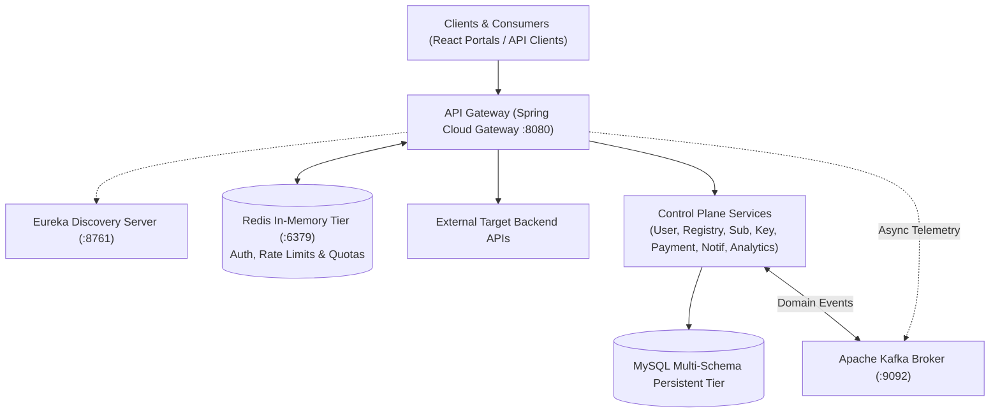

# APIShield

APIShield is an enterprise-grade API Management and Security Platform built using Java 21, Spring Boot Microservices, and React.

The platform empowers API owners to publish, secure, and monetize their backend APIs, while enabling developers to discover APIs through an interactive marketplace, subscribe to plans, generate cryptographically secure API keys, and consume external APIs through a high-performance API Gateway.

---

## Technology Stack

- **Backend:** Java 21 LTS, Spring Boot 3.3+, Spring Cloud Gateway, Spring Cloud Netflix Eureka, Spring Security, Maven Multi-Module
- **Data & In-Memory:** MySQL 8.0+ (Logical Database-per-Service), Redis 7.x
- **Event Streaming:** Apache Kafka 3.x
- **Payments:** Razorpay (Initial Payment Provider)
- **Resilience & Observability:** Resilience4j, Prometheus, Grafana
- **Infrastructure & Containerization:** Docker, Docker Compose
- **Frontend:** React (SPA), JavaScript

---

## High-Level Architecture

APIShield separates the **Control Plane** (management operations, user authentication, subscription lifecycle, payments, and analytics dashboards) from the **Data Plane** (high-throughput API proxying, in-memory API key validation, token bucket rate limiting, and asynchronous telemetry streaming).



---

## Repository Structure

The project is structured as a monorepo organizing backend microservices, frontend applications, infrastructure configurations, and technical specifications:

```
APIShield/
├── backend/
│   ├── common/                   # Minimal shared contracts, DTOs & Kafka event envelopes
│   ├── api-gateway/              # Spring Cloud Gateway edge reverse proxy & rate limiter
│   ├── user-service/             # User accounts, authentication & RBAC (JWT)
│   ├── api-registry-service/     # API specs, endpoints & pricing plan management
│   ├── subscription-service/     # Developer plan subscriptions & state machine
│   ├── api-key-service/          # Cryptographic API key generation & hashing
│   ├── payment-service/          # Billing, Razorpay orders & payment webhooks
│   ├── notification-service/     # Transactional emails & system alerts
│   ├── analytics-service/        # Request logs ingestion & usage rollups
│   └── discovery-server/         # Netflix Eureka service registry
├── frontend/                     # React Single Page Application (Developer & Owner Portals)
├── infrastructure/
│   ├── docker/                   # Docker Compose environment configurations
│   ├── mysql/                    # Database init scripts & schema separation
│   ├── redis/                    # Redis configuration & rate limiting Lua scripts
│   ├── kafka/                    # Kafka topic definitions & broker config
│   └── monitoring/               # Prometheus & Grafana dashboard provisioning
├── docs/
│   └── architecture/             # Complete technical architecture documentation
├── tests/                        # End-to-end integration and smoke tests
└── README.md                     # Monorepo root overview
```

---

## Architecture Documentation

For complete technical specifications, review the architecture documents:

- [Architecture Overview](file:///d:/Notes/SEM%20VII/Microservices/API_Shield/docs/architecture/overview.md) — System tenets, user personas, high-level design, and tech stack rationale.
- [Microservices Architecture](file:///d:/Notes/SEM%20VII/Microservices/API_Shield/docs/architecture/microservices.md) — Service boundaries, core operations, data ownership, and failure modes.
- [Database Design](file:///d:/Notes/SEM%20VII/Microservices/API_Shield/docs/architecture/database-design.md) — Schema definitions, entity fields, indexes, and ER diagram.
- [Service Communication](file:///d:/Notes/SEM%20VII/Microservices/API_Shield/docs/architecture/communication.md) — REST, Kafka events, Redis caching, and rate limiting strategies.
- [Complete System Flows](file:///d:/Notes/SEM%20VII/Microservices/API_Shield/docs/architecture/request-flows.md) — Sequence diagrams, Gateway 9-phase lifecycle, and RFC 7807 error handling.
- [Security Architecture](file:///d:/Notes/SEM%20VII/Microservices/API_Shield/docs/architecture/security.md) — JWT RBAC, API key hashing, SSRF prevention, and idempotency.

---

## Prerequisites & Setup Guidelines

### Prerequisites
- **Java Development Kit (JDK):** Version 21 LTS
- **Build Tool:** Apache Maven 3.9+
- **Node.js:** Node 20 LTS & npm
- **Container Engine:** Docker Engine 24+ and Docker Compose v2+

### Quick Start & Local Development

#### Build Backend Microservices
```bash
# Build all backend modules and execute test suite (108 tests)
cd backend
./mvnw clean test
```

#### Run Eureka Discovery Server
```bash
cd backend/discovery-server
../mvnw spring-boot:run
# Eureka Dashboard: http://localhost:8761
```

#### Run User Service
```bash
cd backend/user-service
../mvnw spring-boot:run
# User Service API: http://localhost:8081
```
