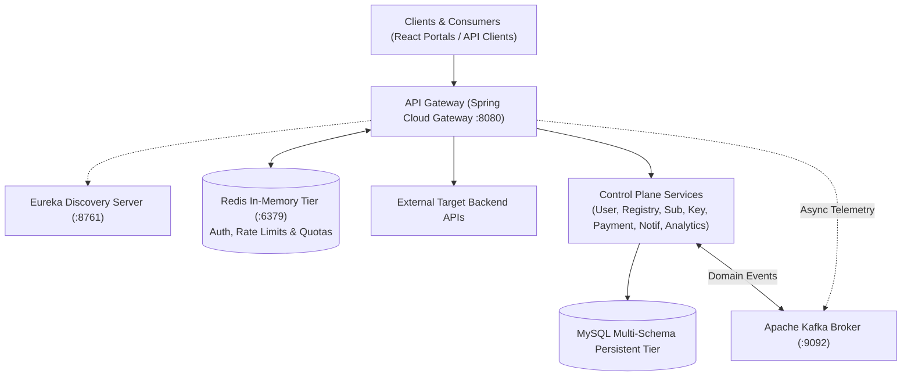

# APIShield

APIShield is an enterprise-grade API Management and Security Platform built using Java 21, Spring Boot Microservices, and React.

The platform empowers API owners to publish, secure, and monetize their backend APIs, while enabling developers to discover APIs through an interactive marketplace, subscribe to plans, generate cryptographically secure API keys, and consume external APIs through a high-performance API Gateway.

---

## Technology Stack

- **Backend:** Java 21 LTS, Spring Boot 3.3+, Spring Cloud Gateway, Spring Cloud Netflix Eureka, Spring Security, Maven Multi-Module
- **Data & In-Memory:** MySQL 8.0+ (Logical Database-per-Service), Redis 7.x
- **Event Streaming:** Apache Kafka 3.x
- **Payments:** Razorpay (Initial Payment Provider)
- **Resilience & Observability:** Resilience4j, Prometheus, Grafana
- **Infrastructure & Containerization:** Docker, Docker Compose
- **Frontend:** React (SPA), JavaScript

---

## High-Level Architecture

APIShield separates the **Control Plane** (management operations, user authentication, subscription lifecycle, payments, and analytics dashboards) from the **Data Plane** (high-throughput API proxying, in-memory API key validation, token bucket rate limiting, and asynchronous telemetry streaming).



---

## Repository Structure

The project is structured as a monorepo organizing backend microservices, frontend applications, infrastructure configurations, and technical specifications:

```
APIShield/
├── backend/
│   ├── common/                   # Minimal shared contracts, DTOs & Kafka event envelopes
│   ├── api-gateway/              # Spring Cloud Gateway edge reverse proxy & rate limiter
│   ├── user-service/             # User accounts, authentication & RBAC (JWT)
│   ├── api-registry-service/     # API specs, endpoints & pricing plan management
│   ├── subscription-service/     # Developer plan subscriptions & state machine
│   ├── api-key-service/          # Cryptographic API key generation & hashing
│   ├── payment-service/          # Billing, Razorpay orders & payment webhooks
│   ├── notification-service/     # Transactional emails & system alerts
│   ├── analytics-service/        # Request logs ingestion & usage rollups
│   └── discovery-server/         # Netflix Eureka service registry
├── frontend/                     # React Single Page Application (Developer & Owner Portals)
├── infrastructure/
│   ├── docker/                   # Docker Compose environment configurations
│   ├── mysql/                    # Database init scripts & schema separation
│   ├── redis/                    # Redis configuration & rate limiting Lua scripts
│   ├── kafka/                    # Kafka topic definitions & broker config
│   └── monitoring/               # Prometheus & Grafana dashboard provisioning
├── docs/
│   └── architecture/             # Complete technical architecture documentation
├── tests/                        # End-to-end integration and smoke tests
└── README.md                     # Monorepo root overview
```

---

## Architecture Documentation

For complete technical specifications, review the architecture documents:

- [Architecture Overview](file:///d:/Notes/SEM%20VII/Microservices/API_Shield/docs/architecture/overview.md) — System tenets, user personas, high-level design, and tech stack rationale.
- [Microservices Architecture](file:///d:/Notes/SEM%20VII/Microservices/API_Shield/docs/architecture/microservices.md) — Service boundaries, core operations, data ownership, and failure modes.
- [Database Design](file:///d:/Notes/SEM%20VII/Microservices/API_Shield/docs/architecture/database-design.md) — Schema definitions, entity fields, indexes, and ER diagram.
- [Service Communication](file:///d:/Notes/SEM%20VII/Microservices/API_Shield/docs/architecture/communication.md) — REST, Kafka events, Redis caching, and rate limiting strategies.
- [Complete System Flows](file:///d:/Notes/SEM%20VII/Microservices/API_Shield/docs/architecture/request-flows.md) — Sequence diagrams, Gateway 9-phase lifecycle, and RFC 7807 error handling.
- [Security Architecture](file:///d:/Notes/SEM%20VII/Microservices/API_Shield/docs/architecture/security.md) — JWT RBAC, API key hashing, SSRF prevention, and idempotency.

---

---

## Service Port Allocation Matrix

| Service | Port | Protocol | Responsibilities |
| :--- | :---: | :---: | :--- |
| **API Gateway** | `8080` | HTTP / WS | Edge reverse proxy, token bucket rate limiter, JWT routing, Kafka telemetry |
| **User Service** | `8081` | HTTP | Multi-tenant auth, BCrypt, JWT access/refresh rotation, RBAC, audit log |
| **API Registry Service**| `8082` | HTTP | API registration, SSRF validator, tiered plans (Free/Pro), Redis warming |
| **Subscription Service**| `8083` | HTTP | Developer plan subscriptions, lifecycle state machine, plan upgrade/cancel |
| **API Key Service** | `8084` | HTTP | Cryptographic key generator (`ash_live_...`), SHA-256 storage, Redis cache |
| **Payment Service** | `8085` | HTTP | Razorpay orders, billing invoices, webhook signature verification |
| **Notification Service**| `8086` | HTTP | Multi-channel alerts (Email, In-App, Webhook), Kafka event consumers |
| **Analytics Service** | `8087` | HTTP | Telemetry ingestion, time-series rollups, developer quota tracking |
| **Discovery Server** | `8761` | HTTP | Netflix Eureka service discovery & cluster health registry |
| **Frontend Portal** | `80` / `5173` | HTTP | React 18+ SPA (Owner console, Developer marketplace, Admin panel) |
| **MySQL Database** | `3306` | TCP | 7 isolated logical schemas (Database-per-Service principle) |
| **Redis Cache** | `6379` | TCP | Sliding-window token bucket Lua scripts, API key cache, active quotas |
| **Apache Kafka** | `9092` | TCP | KRaft mode event streaming broker (7 canonical domain topics) |
| **Prometheus** | `9090` | HTTP | Timeseries metric collector scraping Spring Boot Actuators |
| **Grafana** | `3000` | HTTP | Pre-provisioned dashboards (Throughput, Latency P50-P99, Error rates) |

---

## Prerequisites & Setup Guidelines

### Prerequisites
- **Java Development Kit (JDK):** Version 21 LTS
- **Build Tool:** Apache Maven 3.9+
- **Node.js:** Node 20 LTS & npm
- **Container Engine:** Docker Engine 24+ and Docker Compose v2+

---

## Deployment & Orchestration

### 1. Full-Stack Docker Compose Orchestration
Launch the entire platform (all 9 microservices, React SPA, MySQL, Redis, Kafka, Prometheus, and Grafana) with a single command:
```bash
docker compose -f infrastructure/docker/docker-compose.yml up -d
```

To view logs or monitor container status:
```bash
docker compose -f infrastructure/docker/docker-compose.yml ps
docker compose -f infrastructure/docker/docker-compose.yml logs -f api-gateway
```

To gracefully stop the platform:
```bash
docker compose -f infrastructure/docker/docker-compose.yml down
```

---

## Automated Testing & Benchmarking

### Backend Multi-Module Reactor Regression Test
Run the complete unit and integration test suite across all 11 Maven modules:
```bash
cd backend
./mvnw clean test
```
*Current test status:* **237 / 237 automated tests passing** (0 failures, 0 errors, 0 skipped).

### Automated End-to-End System Integration Test
Execute the comprehensive 10-step platform lifecycle test suite:
```bash
# Standalone contract verification (runs without external dependencies)
npm --prefix tests/e2e run test:mock

# Live integration against running Docker / Local cluster
npm --prefix tests/e2e run test:live

# PowerShell wrapper
powershell -ExecutionPolicy Bypass -File tests/e2e/e2e-business-journey.ps1 -Mode mock
```

### High-Throughput Gateway Benchmarking
Benchmark the Edge Gateway throughput and latency percentiles (P50, P90, P95, P99):
```bash
node tests/e2e/benchmark.js http://localhost:8080/gateway/weather-api/current ash_live_test_key 100 10
```

---

## Local Development (Running Individual Services)

#### Build Backend Microservices
```bash
cd backend
./mvnw clean test
```

#### Run Edge API Gateway
```bash
cd backend/api-gateway
../mvnw spring-boot:run
# API Gateway: http://localhost:8080
```

#### Run Eureka Discovery Server
```bash
cd backend/discovery-server
../mvnw spring-boot:run
# Eureka Dashboard: http://localhost:8761
```

#### Run User Service
```bash
cd backend/user-service
../mvnw spring-boot:run
# User Service API: http://localhost:8081
```

#### Run React Frontend
```bash
cd frontend
npm run dev
# Frontend Portal: http://localhost:5173
```
