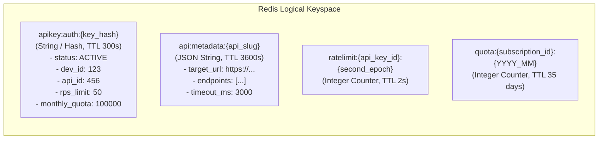
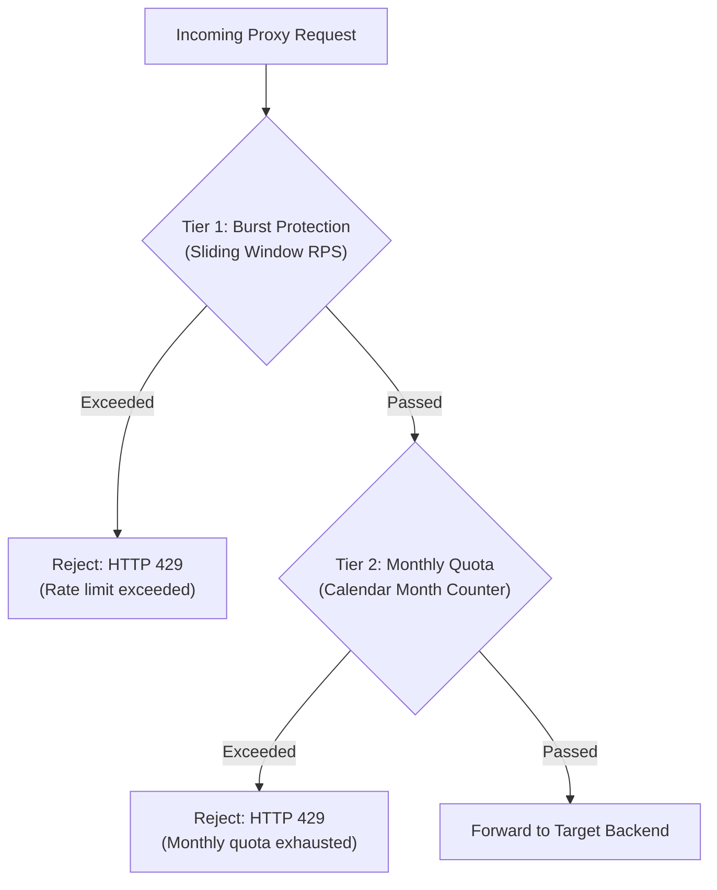
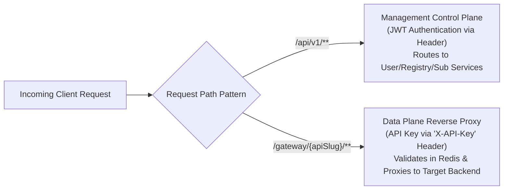

# APIShield — Service Communication & Caching Architecture

## 1. Communication Paradigm Overview

APIShield employs a hybrid communication architecture tailored to the performance and consistency demands of an API management platform:

1. **Synchronous Communication (REST over HTTP/2 & HTTP/1.1):**
   Used where immediate, blocking consistency is required (e.g., user login, generating an API key, reading current configuration) and for client-to-gateway interactions.
2. **Asynchronous Communication (Apache Kafka):**
   Used for high-throughput event streaming, eventual consistency across microservice boundaries, decoupling billing workflows, notification dispatching, and fire-and-forget request telemetry.
3. **In-Memory Distributed State (Redis):**
   Used on the latency-critical Data Plane for sub-millisecond API key authentication, route resolution, token bucket rate limiting, and monthly quota counters.

```mermaid
flowchart TD
    Client["Client / Browser"]
    Gateway["API Gateway"]
    Eureka["Eureka Registry"]
    Redis[("Redis Distributed Cache")]
    Kafka["Apache Kafka"]
    Backend["External Target API"]

    subgraph InternalServices["Control Plane Microservices"]
        UserSvc["User Service"]
        RegistrySvc["Registry Service"]
        SubSvc["Subscription Service"]
        ApiKeySvc["API Key Service"]
        PaymentSvc["Payment Service"]
        NotifSvc["Notification Service"]
        AnalyticsSvc["Analytics Service"]
    end

    %% Client calls
    Client -->|Sync REST /api/v1/**| Gateway
    Client -->|Sync REST /gateway/{slug}/**| Gateway

    %% Eureka Discovery
    Gateway -.->|Heartbeat / Discover| Eureka
    InternalServices -.->|Heartbeat / Discover| Eureka

    %% Control Plane Sync Routing
    Gateway -->|Sync HTTP /api/v1/auth/**| UserSvc
    Gateway -->|Sync HTTP /api/v1/apis/**| RegistrySvc
    Gateway -->|Sync HTTP /api/v1/subscriptions/**| SubSvc
    Gateway -->|Sync HTTP /api/v1/keys/**| ApiKeySvc
    Gateway -->|Sync HTTP /api/v1/payments/**| PaymentSvc
    Gateway -->|Sync HTTP /api/v1/analytics/**| AnalyticsSvc

    %% Inter-service Sync REST
    ApiKeySvc -->|Sync REST (Feign)| SubSvc
    SubSvc -->|Sync REST (Feign)| RegistrySvc

    %% Data Plane Fast Path
    Gateway <-->|Sub-ms Auth & Rate Limit| Redis
    Gateway -->|Non-blocking Proxy| Backend

    %% Asynchronous Kafka Flow
    Gateway -.->|Async Telemetry Stream| Kafka
    PaymentSvc -.->|Async Payment Events| Kafka
    SubSvc -.->|Async Subscription Events| Kafka
    ApiKeySvc -.->|Async Key Events| Kafka
    Kafka -.->|Async Ingest| AnalyticsSvc
    Kafka -.->|Async Ingest| NotifSvc
    Kafka -.->|Async Ingest| SubSvc
```

---

## 2. Synchronous REST Communication

### 2.1 Technology & Client Implementation
- **Spring Cloud OpenFeign & Spring 6 RestClient:** Internal services communicate synchronously using declarative Feign clients integrated with Eureka service discovery.
- **Client-Side Load Balancing:** Spring Cloud LoadBalancer distributes requests across healthy instances retrieved from Eureka.
- **Distributed Request Tracing:** Every incoming request receives an `X-Correlation-ID` (UUID) at the API Gateway. This header is propagated across all downstream REST calls and included in log messages (via MDC) and Kafka event envelopes.

### 2.2 Synchronous Service Dependencies
Synchronous inter-service calls are strictly minimized to prevent distributed deadlocks:
- **API Key Service -> Subscription Service:** Verifies that a developer has an `ACTIVE` subscription before issuing an API key (`GET /api/v1/internal/subscriptions/validate?developerId={devId}&apiId={apiId}`). Protected with Resilience4j circuit breaker.
- **Subscription Service -> API Registry Service:** Validates plan existence and pricing during checkout creation (`GET /api/v1/internal/plans/{planId}`). Protected with local Redis plan caching.
- **API Gateway -> API Key Service (Fallback Only):** If an API key hash is missing from Redis (cache-miss), the Gateway executes an internal fallback REST call (`GET /api/v1/internal/keys/lookup/{keyHash}`) and populates Redis.

---

## 3. Asynchronous Event-Driven Architecture (Apache Kafka)

### 3.1 Event Topics & Contracts

All domain events share a standardized JSON envelope structure defined in the `backend/common` module (`EventEnvelope<T>`), ensuring zero version drift and consistent deserialization across all microservices:

```json
{
  "eventId": "f47ac10b-58cc-4372-a567-0e02b2c3d479",
  "eventType": "subscription.activated",
  "timestamp": 1774000000000,
  "producer": "subscription-service",
  "correlationId": "9b1deb4d-3b7d-4bad-9bdd-2b0d7b3dcb6d",
  "partitionKey": "usr_9921",
  "payload": {
    "subscriptionId": "sub_101",
    "developerId": "usr_9921",
    "apiId": "api_weather_01",
    "planId": "plan_pro_02",
    "status": "ACTIVE",
    "activatedAt": "2026-11-18T10:00:00Z"
  }
}
```

### 3.2 Kafka Topic Specifications

| Topic Name | Producer(s) | Primary Consumer(s) | Partition Key | Purpose & Trigger |
| :--- | :--- | :--- | :--- | :--- |
| `apishield.user.events` | User Service | Notification Service | `userId` | Emits `user.registered`, `user.suspended`. Triggers welcome emails or account freeze. |
| `apishield.registry.events` | Registry Service | API Gateway, Notification | `apiId` | Emits `api.published`, `api.updated`, `api.deprecated`. Triggers Gateway route cache invalidation. |
| `apishield.payment.events` | Payment Service | Subscription Service, Notification Service | `subscriptionId` | Emits `payment.completed`, `payment.failed`. Triggers subscription state transition and invoice email. |
| `apishield.subscription.events`| Subscription Service | API Key Service, Notification, Redis Sync | `subscriptionId` | Emits `subscription.activated`, `subscription.cancelled`, `subscription.expired`. Triggers API key revocation. |
| `apishield.apikey.events` | API Key Service | Notification Service, Redis Sync | `apiKeyId` | Emits `apikey.generated`, `apikey.revoked`. Triggers security alerts and Redis cache evictions. |
| `apishield.gateway.analytics` | API Gateway | Analytics Service | `apiId` | High-volume stream of request telemetry logs (status, latency, bytes, IP). Ingested in micro-batches. |
| `apishield.notification.events`| All Services | Notification Service | `recipientUserId`| Explicit ad-hoc transactional notification requests. |

### 3.3 Consumer Groups & Partitioning
- **Partitioning Strategy:** Events are partitioned by primary entity IDs (`apiId`, `subscriptionId`, `developerId`). This guarantees that all lifecycle events for a specific resource are consumed in strict chronological order within a partition.
- **Consumer Scalability:** The Analytics Service runs as a dedicated consumer group (`apishield-analytics-group`) with multiple consumer threads matching the topic partition count, enabling non-blocking, parallel log consumption.
- **Dead Letter Queue (DLQ):** Messages failing deserialization or causing unrecoverable errors after 3 retry attempts are redirected to `{topic}.DLQ` for human inspection and forensic replay.

---

## 4. Redis Caching & In-Memory Data Strategy

The API Gateway relies on Redis to maintain ultra-fast state for runtime proxy decisions, avoiding any database queries on the critical path.



### 4.1 Cached Structures & TTL Policies

1. **API Key Authentication Cache (`apikey:auth:{key_hash}`):**
   - **Type:** JSON String or Redis Hash.
   - **Payload:** `{"apiKeyId": "...", "developerId": "...", "apiId": "...", "subscriptionId": "...", "status": "ACTIVE", "rateLimitRps": 20, "monthlyQuota": 50000}`.
   - **TTL:** 300 seconds (5 minutes).
   - **Invalidation:** Synchronously deleted or updated by the API Key Service on `apikey.revoked` or `subscription.cancelled`.
2. **API Routing Metadata Cache (`api:metadata:{slug}`):**
   - **Type:** JSON String.
   - **Payload:** `{"apiId": "...", "targetBackendUrl": "https://api.external.com/v1", "timeoutMs": 3000, "status": "PUBLISHED", "allowedEndpoints": [...]}`.
   - **TTL:** 3600 seconds (1 hour).
   - **Invalidation:** Evicted immediately when API Registry Service receives updates or emits `api.updated`.
3. **Rate Limiting Counter (`ratelimit:{api_key_id}:{second_epoch}`):**
   - **Type:** Integer string.
   - **TTL:** 2 seconds.
   - **Mechanism:** Sliding window / token bucket.
4. **Monthly Quota Counter (`quota:{subscription_id}:{YYYY_MM}`):**
   - **Type:** Integer string.
   - **TTL:** 35 days (persists across month boundary for reconciliation).
   - **Mechanism:** Incremented atomically upon each successful 2xx/3xx proxy response.

### 4.2 Cache Stampede & Penetration Mitigation
- **Null Value Caching:** If an API key hash is queried and does not exist in the database, the Gateway caches a negative sentinel value (`apikey:auth:{key_hash} = "NOT_FOUND"`) for 30 seconds to prevent denial-of-service cache penetration attacks on the backend database.
- **Jittered Expiration:** Cache TTLs incorporate a ±10% random jitter to prevent simultaneous mass-expiration of keys.

---

## 5. Redis Rate-Limiting Strategy

### 5.1 Why Gateway + Redis?
Deploying rate limiting as a Gateway filter backed by Redis eliminates the 5–15ms latency overhead of querying a dedicated rate-limiting microservice. Redis operates in-memory with sub-millisecond execution times and native atomic script execution.

### 5.2 Multi-Tier Rate Limiting & Quota Enforcement

APIShield implements a **Dual-Tier Protection Model**:



#### Tier 1: Sliding Window / Token Bucket Burst Limiting (Per Second)
- Enforces the `rate_limit_rps` defined in the API's subscription plan.
- Executed atomically using an optimized Redis Lua script:
  ```lua
  -- KEYS[1]: ratelimit:{apiKeyId}:{current_second}
  -- ARGV[1]: max_rps
  local current = redis.call("INCR", KEYS[1])
  if current == 1 then
      redis.call("EXPIRE", KEYS[1], 2)
  end
  if current > tonumber(ARGV[1]) then
      return 0 -- Rejected
  end
  return 1 -- Allowed
  ```

#### Tier 2: Monthly Quota Enforcement
- Enforces the `quota_monthly` allowance.
- Key format: `quota:{subscriptionId}:{current_year_month}` (e.g., `quota:sub_8831:2026_11`).
- Evaluated before forwarding: If `INCR` exceeds `quota_monthly`, the request is rejected with HTTP 429.
- Successful executions increment the counter atomically.

### 5.3 Standard HTTP Rate Limit Headers
Every response returned by the API Gateway includes standard IETF rate limit headers:
- `X-RateLimit-Limit`: Maximum requests permitted per second.
- `X-RateLimit-Remaining`: Remaining request allowance in current sliding window.
- `X-RateLimit-Reset`: Epoch timestamp when current rate limit window resets.
- `X-Quota-Limit`: Monthly request quota.
- `X-Quota-Remaining`: Remaining calls for the current calendar month.

---

## 6. Eureka Service Discovery Architecture

- **Eureka Server:** Runs at port 8761 as a standalone discovery node.
- **Client Heartbeats:** Every Spring Boot service instance broadcasts a heartbeat every 30 seconds. If Eureka fails to receive 3 consecutive heartbeats (90 seconds), the instance is scheduled for removal from the routing table.
- **Self-Preservation Mode:** Enabled in production to prevent mass instance eviction during intermittent network hiccups between Docker containers.
- **Client Registry Caching:** The API Gateway and Feign clients cache the Eureka service registry locally. Even if Eureka goes down temporarily, traffic routing between services continues uninterrupted using cached host/port pairs.

---

## 7. API Gateway Routing Modes

The API Gateway distinguishes cleanly between two operational planes:



1. **Management Requests (`/api/v1/**`):**
   - Authenticated via `Authorization: Bearer <JWT>` header.
   - Strips or retains auth headers and routes traffic to internal microservice instances registered in Eureka (`lb://USER-SERVICE`, `lb://REGISTRY-SERVICE`, etc.).
2. **Proxy Data Requests (`/gateway/{apiSlug}/**`):**
   - Authenticated via `X-API-Key: <RawKey>` header.
   - Extracts `{apiSlug}`, validates key against Redis, applies rate limits, resolves target backend URL, performs SSRF security filter, strips `/gateway/{apiSlug}` prefix, and dispatches to external server.
