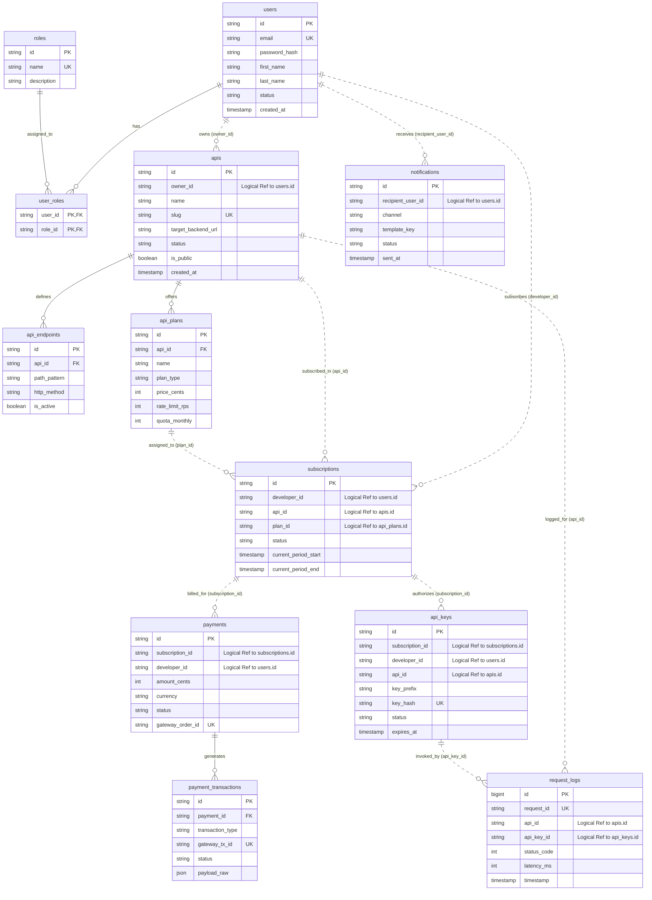

# APIShield — Database Design & Data Architecture

## 1. Data Architecture Philosophy

APIShield adheres strictly to the **Database-per-Service** design pattern. Each microservice encapsulates its own persistent storage domain, ensuring loose coupling, independent schema evolvability, and isolation of failure domains.

### 1.1 Strict Isolation Rules
- **No Shared Databases:** No microservice is permitted to connect to, query, or mutate another microservice's database schema.
- **Logical Schema Separation:** In the initial local development and single-server deployment phase, all services may share one physical MySQL 8.0+ server instance, but each service operates within its own dedicated logical database (schema) using separate database users and credentials:
  - `apishield_user`
  - `apishield_registry`
  - `apishield_subscription`
  - `apishield_apikey`
  - `apishield_payment`
  - `apishield_notification`
  - `apishield_analytics`
- **Zero Cross-Database Foreign Keys:** Referential integrity constraints (`FOREIGN KEY ... REFERENCES`) are strictly restricted to tables *within the same logical schema*. Cross-domain relationships are modeled using immutable UUID string identifiers (e.g. `user_id`, `api_id`, `plan_id`). Consistency across boundaries is maintained via application-level validation and Kafka domain events.
- **Primary Key Strategy:** Distributed UUIDv7 / UUIDv4 represented as `VARCHAR(36)` (or `BINARY(16)` for high-throughput indexes) to prevent auto-increment enumeration attacks and support seamless data migration.
- **Auditability & Concurrency:** All entity tables feature standard audit columns: `created_at` (TIMESTAMP), `updated_at` (TIMESTAMP), and `version` (BIGINT) for JPA optimistic locking.

---

## 2. Logical Schemas & Entity Definitions

### 2.1 User Service (`apishield_user`)

#### Table: `users`
Represents platform accounts (API Owners, Developers, Administrators).

| Column Name | Data Type | Nullable | Constraints / Defaults | Description |
| :--- | :--- | :--- | :--- | :--- |
| `id` | VARCHAR(36) | NO | PRIMARY KEY | Unique user UUID. |
| `email` | VARCHAR(255) | NO | UNIQUE | User login email. |
| `password_hash` | VARCHAR(255) | NO | | BCrypt encrypted password hash. |
| `first_name` | VARCHAR(100) | NO | | User given name. |
| `last_name` | VARCHAR(100) | NO | | User family name. |
| `status` | VARCHAR(30) | NO | DEFAULT 'ACTIVE' | Account state: `ACTIVE`, `PENDING_VERIFICATION`, `SUSPENDED`. |
| `created_at` | TIMESTAMP | NO | DEFAULT CURRENT_TIMESTAMP | Record creation timestamp. |
| `updated_at` | TIMESTAMP | NO | DEFAULT CURRENT_TIMESTAMP ON UPDATE CURRENT_TIMESTAMP | Record modification timestamp. |
| `version` | BIGINT | NO | DEFAULT 0 | Optimistic locking version. |

#### Table: `roles`
Enumerated authorization roles.

| Column Name | Data Type | Nullable | Constraints / Defaults | Description |
| :--- | :--- | :--- | :--- | :--- |
| `id` | VARCHAR(36) | NO | PRIMARY KEY | Unique role UUID. |
| `name` | VARCHAR(50) | NO | UNIQUE | Role identifier: `ROLE_OWNER`, `ROLE_DEVELOPER`, `ROLE_ADMIN`. |
| `description` | VARCHAR(255) | YES | | Human-readable role description. |

#### Table: `user_roles`
Join table linking users and roles.

| Column Name | Data Type | Nullable | Constraints / Defaults | Description |
| :--- | :--- | :--- | :--- | :--- |
| `user_id` | VARCHAR(36) | NO | FK -> `users(id)` ON DELETE CASCADE | Target user reference. |
| `role_id` | VARCHAR(36) | NO | FK -> `roles(id)` ON DELETE CASCADE | Target role reference. |

*Primary Key:* `(user_id, role_id)`

---

### 2.2 API Registry Service (`apishield_registry`)

#### Table: `apis`
Core catalog of APIs registered by API Owners.

| Column Name | Data Type | Nullable | Constraints / Defaults | Description |
| :--- | :--- | :--- | :--- | :--- |
| `id` | VARCHAR(36) | NO | PRIMARY KEY | Unique API UUID. |
| `owner_id` | VARCHAR(36) | NO | INDEX | Logical reference to `users.id` in User Service. |
| `name` | VARCHAR(150) | NO | | User-facing display name of the API. |
| `slug` | VARCHAR(100) | NO | UNIQUE | URL slug for routing (e.g. `weather-service`). |
| `description` | TEXT | YES | | Detailed description and documentation. |
| `category` | VARCHAR(50) | NO | | Category: `AI`, `FINANCE`, `UTILITIES`, etc. |
| `target_backend_url`| VARCHAR(500) | NO | | Target destination URL (e.g. `https://api.weather.com/v1`). |
| `status` | VARCHAR(30) | NO | DEFAULT 'PUBLISHED' | Status: `DRAFT`, `PUBLISHED`, `DEPRECATED`, `BLOCKED`. |
| `version_label` | VARCHAR(20) | NO | DEFAULT 'v1' | Semantic version label (e.g. `v1.0.0`). |
| `is_public` | BOOLEAN | NO | DEFAULT TRUE | Visibility flag in marketplace catalog. |
| `created_at` | TIMESTAMP | NO | DEFAULT CURRENT_TIMESTAMP | Record creation timestamp. |
| `updated_at` | TIMESTAMP | NO | DEFAULT CURRENT_TIMESTAMP ON UPDATE CURRENT_TIMESTAMP | Record modification timestamp. |
| `version` | BIGINT | NO | DEFAULT 0 | Optimistic locking version. |

#### Table: `api_endpoints`
Specific paths and HTTP operations exposed by the registered API.

| Column Name | Data Type | Nullable | Constraints / Defaults | Description |
| :--- | :--- | :--- | :--- | :--- |
| `id` | VARCHAR(36) | NO | PRIMARY KEY | Unique endpoint UUID. |
| `api_id` | VARCHAR(36) | NO | FK -> `apis(id)` ON DELETE CASCADE | Associated API reference. |
| `path_pattern` | VARCHAR(255) | NO | | Endpoint relative path (e.g. `/current`, `/forecast/**`). |
| `http_method` | VARCHAR(10) | NO | | Allowed HTTP verb: `GET`, `POST`, `PUT`, `DELETE`, `ALL`. |
| `description` | VARCHAR(255) | YES | | Endpoint purpose and parameter notes. |
| `is_active` | BOOLEAN | NO | DEFAULT TRUE | Endpoint active flag. |
| `created_at` | TIMESTAMP | NO | DEFAULT CURRENT_TIMESTAMP | Record creation timestamp. |
| `updated_at` | TIMESTAMP | NO | DEFAULT CURRENT_TIMESTAMP ON UPDATE CURRENT_TIMESTAMP | Record modification timestamp. |

#### Table: `api_plans`
Monetization, rate limits, and quota rules for an API.

| Column Name | Data Type | Nullable | Constraints / Defaults | Description |
| :--- | :--- | :--- | :--- | :--- |
| `id` | VARCHAR(36) | NO | PRIMARY KEY | Unique plan UUID. |
| `api_id` | VARCHAR(36) | NO | FK -> `apis(id)` ON DELETE CASCADE | Associated API reference. |
| `name` | VARCHAR(50) | NO | | Plan name (e.g., `Free Tier`, `Pro Tier`). |
| `plan_type` | VARCHAR(20) | NO | DEFAULT 'FREE' | Plan pricing model: `FREE`, `PAID`. |
| `price_cents` | INT | NO | DEFAULT 0 | Cost in minor currency units (e.g. 2900 for $29.00). |
| `billing_cycle` | VARCHAR(20) | NO | DEFAULT 'MONTHLY' | Cycle: `FREE`, `MONTHLY`, `ANNUAL`. |
| `rate_limit_rps` | INT | NO | DEFAULT 10 | Max burst requests per second (RPS). |
| `quota_monthly` | INT | NO | DEFAULT 10000 | Max total requests allowed per calendar month. |
| `is_active` | BOOLEAN | NO | DEFAULT TRUE | Active availability flag. |
| `created_at` | TIMESTAMP | NO | DEFAULT CURRENT_TIMESTAMP | Record creation timestamp. |
| `updated_at` | TIMESTAMP | NO | DEFAULT CURRENT_TIMESTAMP ON UPDATE CURRENT_TIMESTAMP | Record modification timestamp. |

---

### 2.3 Subscription Service (`apishield_subscription`)

#### Table: `subscriptions`
Tracks a developer's contractual subscription to an API's plan.

| Column Name | Data Type | Nullable | Constraints / Defaults | Description |
| :--- | :--- | :--- | :--- | :--- |
| `id` | VARCHAR(36) | NO | PRIMARY KEY | Unique subscription UUID. |
| `developer_id` | VARCHAR(36) | NO | INDEX | Logical reference to `users.id` in User Service. |
| `api_id` | VARCHAR(36) | NO | INDEX | Logical reference to `apis.id` in Registry Service. |
| `plan_id` | VARCHAR(36) | NO | INDEX | Logical reference to `api_plans.id` in Registry Service. |
| `status` | VARCHAR(30) | NO | DEFAULT 'PENDING' | Status: `PENDING`, `ACTIVE`, `CANCELLED`, `EXPIRED`, `SUSPENDED`. |
| `current_period_start`| TIMESTAMP | NO | | Current billing/usage cycle start date. |
| `current_period_end` | TIMESTAMP | NO | | Current billing/usage cycle expiration date. |
| `auto_renew` | BOOLEAN | NO | DEFAULT TRUE | Automatic renewal flag. |
| `created_at` | TIMESTAMP | NO | DEFAULT CURRENT_TIMESTAMP | Record creation timestamp. |
| `updated_at` | TIMESTAMP | NO | DEFAULT CURRENT_TIMESTAMP ON UPDATE CURRENT_TIMESTAMP | Record modification timestamp. |
| `version` | BIGINT | NO | DEFAULT 0 | Optimistic locking version. |

*Unique Composite Index:* `(developer_id, api_id, status)` prevents duplicate active subscriptions to the same API.

---

### 2.4 API Key Service (`apishield_apikey`)

#### Table: `api_keys`
Stores cryptographic metadata for client API keys.

| Column Name | Data Type | Nullable | Constraints / Defaults | Description |
| :--- | :--- | :--- | :--- | :--- |
| `id` | VARCHAR(36) | NO | PRIMARY KEY | Unique API key UUID. |
| `subscription_id` | VARCHAR(36) | NO | INDEX | Logical reference to `subscriptions.id` in Subscription Service. |
| `developer_id` | VARCHAR(36) | NO | INDEX | Logical reference to `users.id` in User Service. |
| `api_id` | VARCHAR(36) | NO | INDEX | Logical reference to `apis.id` in Registry Service. |
| `name` | VARCHAR(100) | NO | DEFAULT 'Default Key' | Friendly name given by developer. |
| `key_prefix` | VARCHAR(12) | NO | INDEX | First 8-12 characters of raw key for identification (e.g. `ash_live_a1b2`). |
| `key_hash` | VARCHAR(64) | NO | UNIQUE | SHA-256 cryptographic digest of the complete raw key. |
| `status` | VARCHAR(20) | NO | DEFAULT 'ACTIVE' | Key state: `ACTIVE`, `REVOKED`, `EXPIRED`. |
| `expires_at` | TIMESTAMP | YES | | Optional expiration timestamp. |
| `last_used_at` | TIMESTAMP | YES | | Timestamp of most recent request using this key. |
| `created_at` | TIMESTAMP | NO | DEFAULT CURRENT_TIMESTAMP | Record creation timestamp. |
| `updated_at` | TIMESTAMP | NO | DEFAULT CURRENT_TIMESTAMP ON UPDATE CURRENT_TIMESTAMP | Record modification timestamp. |

*Index:* `(key_hash, status)` for ultra-fast fallback verification queries.

---

### 2.5 Payment Service (`apishield_payment`)

#### Table: `payments`
High-level payment and invoice records.

| Column Name | Data Type | Nullable | Constraints / Defaults | Description |
| :--- | :--- | :--- | :--- | :--- |
| `id` | VARCHAR(36) | NO | PRIMARY KEY | Unique payment UUID. |
| `subscription_id` | VARCHAR(36) | NO | INDEX | Logical reference to `subscriptions.id` in Subscription Service. |
| `developer_id` | VARCHAR(36) | NO | INDEX | Logical reference to `users.id` in User Service. |
| `amount_cents` | INT | NO | | Billed amount in minor currency units (e.g. 2900 = $29.00). |
| `currency` | VARCHAR(3) | NO | DEFAULT 'USD' | ISO 4217 currency code. |
| `status` | VARCHAR(30) | NO | DEFAULT 'INITIATED' | Status: `INITIATED`, `SUCCESS`, `FAILED`, `REFUNDED`. |
| `payment_gateway` | VARCHAR(50) | NO | DEFAULT 'RAZORPAY' | Initial provider: `RAZORPAY` (extensible to `STRIPE`, `MOCK`). |
| `gateway_order_id` | VARCHAR(255) | YES | UNIQUE | Razorpay Order ID (`order_...`). |
| `gateway_payment_id` | VARCHAR(255) | YES | INDEX | Razorpay Payment ID (`pay_...`). |
| `created_at` | TIMESTAMP | NO | DEFAULT CURRENT_TIMESTAMP | Record creation timestamp. |
| `updated_at` | TIMESTAMP | NO | DEFAULT CURRENT_TIMESTAMP ON UPDATE CURRENT_TIMESTAMP | Record modification timestamp. |

#### Table: `payment_transactions`
Detailed ledger of specific transaction events and webhooks.

| Column Name | Data Type | Nullable | Constraints / Defaults | Description |
| :--- | :--- | :--- | :--- | :--- |
| `id` | VARCHAR(36) | NO | PRIMARY KEY | Unique transaction record UUID. |
| `payment_id` | VARCHAR(36) | NO | FK -> `payments(id)` ON DELETE CASCADE | Associated parent payment. |
| `transaction_type`| VARCHAR(30) | NO | | Type: `CHARGE`, `REFUND`, `DISPUTE`. |
| `gateway_tx_id` | VARCHAR(255) | NO | UNIQUE | External processor's transaction/charge identifier. |
| `status` | VARCHAR(30) | NO | | Gateway status: `SUCCEEDED`, `DECLINED`, `PENDING`. |
| `payload_raw` | JSON | YES | | Full raw JSON webhook payload for audit and forensics. |
| `error_code` | VARCHAR(100) | YES | | Gateway-specific failure reason code. |
| `error_message` | VARCHAR(500) | YES | | Human-readable decline reason. |
| `created_at` | TIMESTAMP | NO | DEFAULT CURRENT_TIMESTAMP | Record creation timestamp. |

---

### 2.6 Notification Service (`apishield_notification`)

#### Table: `notifications`
Audit trail of sent or pending system notifications.

| Column Name | Data Type | Nullable | Constraints / Defaults | Description |
| :--- | :--- | :--- | :--- | :--- |
| `id` | VARCHAR(36) | NO | PRIMARY KEY | Unique notification UUID. |
| `recipient_user_id`| VARCHAR(36) | NO | INDEX | Logical reference to `users.id` in User Service. |
| `channel` | VARCHAR(20) | NO | DEFAULT 'EMAIL' | Channel: `EMAIL`, `IN_APP`, `WEBHOOK`. |
| `template_key` | VARCHAR(100) | NO | | Template identifier: `WELCOME_EMAIL`, `KEY_REVOKED`, etc. |
| `title` | VARCHAR(255) | NO | | Notification subject line or notification title. |
| `content_payload` | JSON | NO | | Parameters/data injected into template. |
| `status` | VARCHAR(20) | NO | DEFAULT 'PENDING' | Status: `PENDING`, `SENT`, `FAILED`. |
| `sent_at` | TIMESTAMP | YES | | Timestamp of actual dispatch. |
| `retry_count` | INT | NO | DEFAULT 0 | Count of delivery attempts. |
| `created_at` | TIMESTAMP | NO | DEFAULT CURRENT_TIMESTAMP | Record creation timestamp. |

---

### 2.7 Analytics Service (`apishield_analytics`)

#### Table: `request_logs`
High-volume raw request telemetry emitted from Gateway via Kafka.

| Column Name | Data Type | Nullable | Constraints / Defaults | Description |
| :--- | :--- | :--- | :--- | :--- |
| `id` | BIGINT AUTO_INCREMENT | NO | PRIMARY KEY | Fast sequential ID for write throughput. |
| `request_id` | VARCHAR(36) | NO | UNIQUE | Correlation UUID generated at API Gateway. |
| `api_id` | VARCHAR(36) | NO | INDEX | Logical reference to `apis.id`. |
| `developer_id` | VARCHAR(36) | YES | INDEX | Logical reference to `users.id` (null if unauthenticated). |
| `api_key_id` | VARCHAR(36) | YES | INDEX | Logical reference to `api_keys.id`. |
| `endpoint_path` | VARCHAR(500) | NO | | Requested path (e.g. `/weather/current`). |
| `http_method` | VARCHAR(10) | NO | | HTTP Verb: `GET`, `POST`, etc. |
| `status_code` | INT | NO | | Downstream HTTP response code (200, 429, 502, etc.). |
| `latency_ms` | INT | NO | | Total execution latency in milliseconds. |
| `client_ip` | VARCHAR(45) | YES | | Origin IP address (IPv4 or IPv6). |
| `user_agent` | VARCHAR(255) | YES | | Requesting client User-Agent string. |
| `timestamp` | TIMESTAMP | NO | INDEX | Request arrival timestamp at Gateway. |

*Partitioning Strategy:* In production environments, `request_logs` is range-partitioned by month (`timestamp`), allowing historical partition drops after 30 days.

#### Table: `usage_statistics`
Aggregated hourly and daily usage rollups powering charts and billing reconciliation.

| Column Name | Data Type | Nullable | Constraints / Defaults | Description |
| :--- | :--- | :--- | :--- | :--- |
| `id` | BIGINT AUTO_INCREMENT | NO | PRIMARY KEY | Internal primary key. |
| `api_id` | VARCHAR(36) | NO | | Target API identifier. |
| `developer_id` | VARCHAR(36) | NO | | Subscribing developer identifier. |
| `plan_id` | VARCHAR(36) | NO | | Active subscription plan identifier. |
| `period_date` | DATE | NO | | Aggregate date (YYYY-MM-DD). |
| `period_hour` | SMALLINT | YES | | Hour of day (0-23, or NULL for daily rollup). |
| `total_requests` | BIGINT | NO | DEFAULT 0 | Count of all requests received. |
| `successful_requests`| BIGINT | NO | DEFAULT 0 | Count of 2xx responses. |
| `client_errors` | BIGINT | NO | DEFAULT 0 | Count of 4xx responses (excluding 429). |
| `server_errors` | BIGINT | NO | DEFAULT 0 | Count of 5xx responses. |
| `blocked_rate_limit`| BIGINT | NO | DEFAULT 0 | Count of 429 Rate Limit rejections. |
| `blocked_auth` | BIGINT | NO | DEFAULT 0 | Count of 401/403 Auth rejections. |
| `avg_latency_ms` | INT | NO | DEFAULT 0 | Average latency in ms during the period. |
| `created_at` | TIMESTAMP | NO | DEFAULT CURRENT_TIMESTAMP | Record creation timestamp. |
| `updated_at` | TIMESTAMP | NO | DEFAULT CURRENT_TIMESTAMP ON UPDATE CURRENT_TIMESTAMP | Record update timestamp. |

*Unique Composite Index:* `(api_id, developer_id, period_date, period_hour)` allows atomic `ON DUPLICATE KEY UPDATE` aggregation.

---

## 3. Entity-Relationship (ER) Diagram

The following diagram illustrates all domain entities across the logical schemas. Note that solid lines denote physical foreign keys *within* a schema, while dashed lines denote logical cross-service references maintained via UUIDs and Kafka events.



---

## 4. High-Performance Indexing Strategy

To guarantee that queries remain fast as records scale into millions of rows:

1. **API Key Hash Lookup (`apishield_apikey.api_keys`):**
   ```sql
   CREATE UNIQUE INDEX idx_api_keys_key_hash ON api_keys(key_hash);
   CREATE INDEX idx_api_keys_sub_status ON api_keys(subscription_id, status);
   ```
   *Purpose:* Fast indexed lookup with logarithmic complexity ($O(\log N)$) on cache-miss fallback at the Gateway (contrasting with the $O(1)$ constant-time lookup in the in-memory Redis cache).

2. **Active Subscription Lookup (`apishield_subscription.subscriptions`):**
   ```sql
   CREATE INDEX idx_subscriptions_dev_api_status ON subscriptions(developer_id, api_id, status);
   ```
   *Purpose:* Fast verification of developer's eligibility when generating keys.

3. **API Slug Resolution (`apishield_registry.apis`):**
   ```sql
   CREATE UNIQUE INDEX idx_apis_slug ON apis(slug);
   CREATE INDEX idx_apis_owner ON apis(owner_id);
   ```
   *Purpose:* Routing path matching at Gateway and owner management listing.

4. **Analytics Timeseries (`apishield_analytics.request_logs`):**
   ```sql
   CREATE INDEX idx_logs_api_timestamp ON request_logs(api_id, timestamp);
   CREATE INDEX idx_logs_dev_timestamp ON request_logs(developer_id, timestamp);
   ```
   *Purpose:* Range scans for owner and developer dashboard charts.
