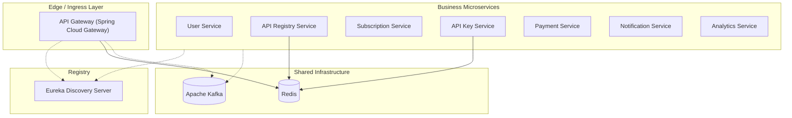
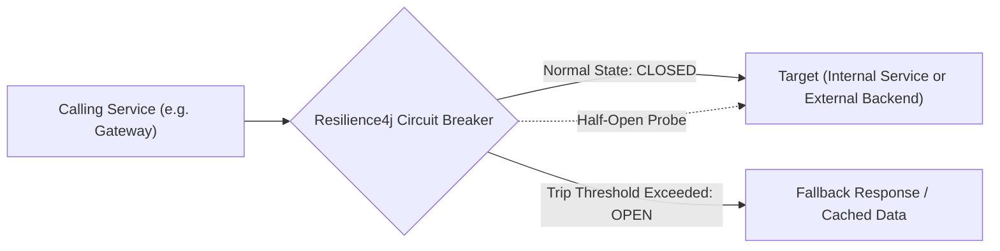

# APIShield — Microservices Architecture Specification

## 1. Overview of Microservices Ecosystem

APIShield decomposes the API management problem domain into specialized, loosely coupled microservices. Each microservice encapsulates a cohesive business boundary (Bounded Context in Domain-Driven Design), owns its database schema, and communicates with other services through well-defined asynchronous events or synchronous REST contracts.



### 1.1 Maven Multi-Module Architecture & Minimal Common Module

The backend is structured as a **Maven Multi-Module Project** managed via `backend/pom.xml`. The root POM defines centralized dependency versions (`<dependencyManagement>`) for Spring Boot, Spring Cloud, Kafka, and Jackson, preventing version skew and security drift across services.

```
backend/
├── pom.xml                       # Aggregator & Central Dependency Management (<dependencyManagement>)
├── common/                       # Minimal shared contracts, DTOs, Kafka envelopes & utility classes
├── discovery-server/             # Eureka Server
├── api-gateway/                  # Spring Cloud Gateway
├── user-service/
├── api-registry-service/
├── subscription-service/
├── api-key-service/
├── payment-service/
├── notification-service/
└── analytics-service/
```

#### Responsibility & Strict Boundary Rules for `backend/common`:
To prevent the common module from eroding service autonomy or creating a "distributed monolith" coupling trap:
- **Allowed in `backend/common`:**
  - Common Kafka event envelope (`EventEnvelope<T>`, `EventMetadata`).
  - Shared domain event payload DTOs (`UserRegisteredEvent`, `SubscriptionActivatedEvent`, `PaymentCompletedEvent`, `ApiKeyRevokedEvent`).
  - Standardized RFC 7807 problem details model (`ProblemDetailResponse`).
  - Shared HTTP header constants (`X-Correlation-ID`, `X-Internal-Token`, `X-API-Key`).
  - Lightweight cryptographic helper (e.g. standard SHA-256 string hasher).
- **Strictly Prohibited from `backend/common`:**
  - **No JPA `@Entity` classes:** Each microservice defines and owns its own persistence models.
  - **No Spring Data Repositories:** Database access code is strictly private to each service.
  - **No Business Logic or Services:** Domain rules reside exclusively within service boundaries.
  - **No Heavy Third-Party SDKs:** Third-party provider SDKs (such as Razorpay) belong exclusively in the respective service POM.

---

## 2. Service Specifications

### 2.1 Eureka Discovery Server

- **Primary Responsibility:**
  Provides centralized service registration and discovery for all internal Spring Boot microservices and the API Gateway. It tracks service health via heartbeats and allows dynamic client-side load balancing.
- **Core Operations:**
  - `POST /eureka/apps/{appName}`: Instance registration.
  - `PUT /eureka/apps/{appName}/{instanceId}`: Periodic heartbeat renewal (default every 30 seconds).
  - `DELETE /eureka/apps/{appName}/{instanceId}`: Instance deregistration on shutdown.
  - `GET /eureka/apps`: Full registry fetch for client-side routing caches.
- **Data Ownership:**
  Ephemeral in-memory registry table. No persistent database required.
- **External Communication:**
  Accepts HTTP heartbeats and queries from internal microservice instances.
- **Dependencies on Other Services:** None.
- **Resilience & Failure Modes:**
  Operates in Eureka Self-Preservation mode to avoid evicting healthy instances during transient network partitions. If Eureka becomes temporarily unreachable, clients continue functioning using local in-memory registry caches.

---

### 2.2 API Gateway

- **Primary Responsibility:**
  Serves as the single edge ingress for all external clients. It performs two distinct roles:
  1. **Control Plane Ingress:** Authenticates JWT tokens and reverse-proxies management requests to downstream services (`/api/v1/**`).
  2. **Data Plane Reverse Proxy:** Intercepts consumer API traffic (`/gateway/{apiSlug}/**`), authenticates API keys against Redis, validates subscription status, enforces burst rate limits and monthly quotas via Redis, validates target backend safety (SSRF checks), forwards requests to external third-party backends, and emits asynchronous telemetry events to Kafka.
  > [!NOTE]
  > **Rate Limiting Architectural Decision:** Rate limiting is implemented directly inside the API Gateway using custom Project Reactor filters and Redis Lua scripts rather than an unnecessary standalone microservice. This eliminates network hops and keeps proxy latency sub-millisecond.
- **Core Operations:**
  - `ALL /gateway/{apiSlug}/**`: Public consumer traffic proxying.
  - `ALL /api/v1/auth/**`: Proxied to User Service.
  - `ALL /api/v1/apis/**`: Proxied to API Registry Service.
  - `ALL /api/v1/subscriptions/**`: Proxied to Subscription Service.
  - `ALL /api/v1/keys/**`: Proxied to API Key Service.
  - `ALL /api/v1/payments/**`: Proxied to Payment Service.
  - `ALL /api/v1/analytics/**`: Proxied to Analytics Service.
- **Data Ownership:**
  Stateless. Owns no persistent database. Maintains transient Redis cache keys for fast lookup:
  - `apikey:auth:{key_hash}`
  - `api:metadata:{api_slug}`
  - `ratelimit:{api_key_id}:{second_epoch}`
  - `quota:{subscription_id}:{YYYY_MM}`
- **External Communication:**
  - **Inbound:** External HTTP/HTTPS client requests.
  - **Outbound HTTP:** External target backend APIs (via WebClient / Netty HttpClient); internal microservices (via Eureka route discovery).
  - **Outbound Kafka:** Telemetry topic `apishield.gateway.analytics`.
  - **Redis:** Reads and updates rate limits, quotas, and cache lookups.
- **Dependencies on Other Services:**
  Eureka (for discovering internal services), Redis (for key auth and rate limiting), Kafka (for telemetry).
- **Resilience & Failure Modes:**
  Resilience4j Circuit Breakers prevent target backend failures from exhausting gateway connection pools. Fallback to HTTP 504 on target timeouts and HTTP 502 on connection drops. If Redis fails, gateway can be configured with a fail-safe mode (e.g. reject with 503 or allow with degraded rate limiting).

---

### 2.3 User Service

- **Primary Responsibility:**
  Manages platform user accounts, credential storage, role assignment (`ROLE_OWNER`, `ROLE_DEVELOPER`, `ROLE_ADMIN`), user profile management, and authentication via secure JSON Web Tokens (JWT).
- **Core Operations:**
  - `POST /api/v1/auth/register`: User signup (Owner or Developer).
  - `POST /api/v1/auth/login`: Authenticates credentials, returns JWT Access Token (15 min) & Refresh Token (7 days).
  - `POST /api/v1/auth/refresh`: Issues a new Access Token using a valid Refresh Token.
  - `GET /api/v1/users/me`: Retrieves current authenticated user profile.
  - `PUT /api/v1/users/me`: Updates profile details.
  - `GET /api/v1/users/{id}`: Internal endpoint for resolving user details by ID.
- **Data Ownership:**
  Logical database: `apishield_user`
  Tables: `users`, `roles`, `user_roles`
- **External Communication:**
  - **Inbound REST:** Handled via API Gateway routing.
  - **Outbound Kafka:** Publishes to `apishield.user.events` (`user.registered`, `user.updated`, `user.suspended`).
- **Dependencies on Other Services:**
  Kafka (for emitting user lifecycle events).
- **Resilience & Failure Modes:**
  Database connection pooling via HikariCP. BCrypt password hashing is tuned with sufficient work factor. If Kafka is unavailable, user registration persists in MySQL and event publishing is retried using an outbox pattern.

---

### 2.4 API Registry Service

- **Primary Responsibility:**
  Acts as the catalog and configuration authority for APIs published by API Owners. Handles API metadata, target backend URLs, endpoint patterns, allowed HTTP methods, documentation, and pricing/subscription plans (Free, Basic, Pro, Enterprise).
- **Core Operations:**
  - `POST /api/v1/apis`: Register a new API and target backend (Owner).
  - `GET /api/v1/apis`: List APIs owned by current user (Owner).
  - `GET /api/v1/apis/{id}`: Fetch detailed API configuration.
  - `PUT /api/v1/apis/{id}`: Update API configuration, endpoints, or backend URLs.
  - `DELETE /api/v1/apis/{id}`: Deprecate or soft-delete an API.
  - `POST /api/v1/apis/{id}/endpoints`: Define API endpoint path patterns.
  - `POST /api/v1/apis/{id}/plans`: Configure monetization and rate-limit plans.
  - `GET /api/v1/catalog`: Public marketplace catalog of active, public APIs.
  - `GET /api/v1/internal/apis/resolve/{slug}`: Internal fast-resolution endpoint for Gateway cache warming.
- **Data Ownership:**
  Logical database: `apishield_registry`
  Tables: `apis`, `api_endpoints`, `api_plans`
- **External Communication:**
  - **Inbound REST:** Owner and marketplace requests.
  - **Outbound Kafka:** Publishes to `apishield.registry.events` (`api.published`, `api.updated`, `api.deprecated`, `plan.created`, `plan.updated`).
  - **Redis:** Directly warms and invalidates `api:metadata:{slug}` keys upon updates.
- **Dependencies on Other Services:**
  User Service (for owner authorization verification via JWT claims), Redis, Kafka.
- **Resilience & Failure Modes:**
  Strict backend URL regex and IP validation (SSRF defense) before persisting any target URL. Circuit breaker on internal lookup requests.

---

### 2.5 Subscription Service

- **Primary Responsibility:**
  Manages the lifecycle of developer subscriptions to API plans. Tracks subscription statuses (`PENDING`, `ACTIVE`, `CANCELLED`, `EXPIRED`, `SUSPENDED`), handles plan upgrades/downgrades, and validates whether a developer has an active right to generate API keys or invoke an API.
- **Core Operations:**
  - `POST /api/v1/subscriptions`: Request subscription to a specific API plan.
  - `GET /api/v1/subscriptions/my`: List subscriptions for the authenticated developer.
  - `GET /api/v1/subscriptions/{id}`: Get subscription status and usage limits.
  - `POST /api/v1/subscriptions/{id}/cancel`: Cancel active subscription.
  - `GET /api/v1/internal/subscriptions/validate`: Internal validation of subscription status.
- **Data Ownership:**
  Logical database: `apishield_subscription`
  Tables: `subscriptions`
- **External Communication:**
  - **Inbound REST:** Developer subscription requests.
  - **Inbound Kafka:** Consumes `apishield.payment.events` (`payment.completed`, `payment.failed`).
  - **Outbound Kafka:** Publishes to `apishield.subscription.events` (`subscription.requested`, `subscription.activated`, `subscription.cancelled`, `subscription.expired`).
- **Dependencies on Other Services:**
  API Registry Service (to fetch plan type and pricing), Payment Service (for paid plans), Kafka.
- **Resilience & Failure Modes:**
  For free plans, immediate activation via internal transactional state change. For paid plans, subscription enters `PENDING` state until `payment.completed` event is received via Kafka, ensuring resilience against synchronous payment network dropouts.

---

### 2.6 API Key Service

- **Primary Responsibility:**
  Issues, cryptographically stores, and manages the lifecycle of client API keys. Enforces key revocation, expiration, and syncs key metadata with Redis so the API Gateway can validate keys with zero database overhead.
- **Core Operations:**
  - `POST /api/v1/keys`: Generate a new API key for an active subscription.
  - `GET /api/v1/keys/my`: List active/revoked API keys (showing only prefix, creation date, and status).
  - `POST /api/v1/keys/{id}/revoke`: Instantly revoke an API key.
  - `GET /api/v1/internal/keys/lookup/{keyHash}`: Internal cache-miss resolution endpoint for Gateway.
- **Data Ownership:**
  Logical database: `apishield_apikey`
  Tables: `api_keys`
- **External Communication:**
  - **Inbound REST:** Key management calls.
  - **Inbound Kafka:** Consumes `apishield.subscription.events` (`subscription.cancelled`, `subscription.expired`). Automatically revokes associated keys.
  - **Outbound Kafka:** Publishes to `apishield.apikey.events` (`apikey.generated`, `apikey.revoked`).
  - **Redis:** Writes active key metadata cache `apikey:auth:{keyHash}`; removes key immediately on revocation.
- **Dependencies on Other Services:**
  Subscription Service (verifies subscription status prior to key generation), Redis, Kafka.
- **Resilience & Failure Modes:**
  Never stores raw keys in the database. Returns raw key in response payload exactly once during creation. Evicts cached Redis keys synchronously upon revocation and emits an event for cluster-wide invalidation.

---

### 2.7 Payment Service

- **Primary Responsibility:**
  Manages billing, invoice generation, checkout order initiation, and payment webhook verification for paid API plans, using **Razorpay** as the initial payment gateway provider.
- **Core Operations:**
  - `POST /api/v1/payments/create-order`: Generates a Razorpay Order (`order_id`) for a subscription.
  - `POST /api/v1/payments/verify`: Verifies client checkout signature (`razorpay_order_id`, `razorpay_payment_id`, `razorpay_signature`).
  - `POST /api/v1/payments/webhook`: Ingests and verifies Razorpay webhook events (`payment.captured`, `payment.failed`, `order.paid`).
  - `GET /api/v1/payments/history`: List developer billing and payment receipts.
  - `GET /api/v1/payments/{id}`: Detailed payment status.
- **Data Ownership:**
  Logical database: `apishield_payment`
  Tables: `payments`, `payment_transactions`
- **External Communication:**
  - **Inbound REST:** Checkout initiation from UI; webhook callbacks from Razorpay.
  - **Outbound HTTP:** Calls to Razorpay API (`https://api.razorpay.com/v1/orders`).
  - **Outbound Kafka:** Publishes to `apishield.payment.events` (`payment.initiated`, `payment.completed`, `payment.failed`, `payment.refunded`).
- **Dependencies on Other Services:**
  Subscription Service (retrieves plan pricing details), Kafka.
- **Resilience & Failure Modes:**
  Razorpay webhooks are verified using HMAC-SHA256 signatures against the configured secret (`X-Razorpay-Signature`). Webhook processing is strictly idempotent using `razorpay_payment_id`. If downstream Kafka is briefly unavailable, the webhook transaction record is committed to MySQL with status `PENDING_DISPATCH` for background relay.

---

### 2.8 Notification Service

- **Primary Responsibility:**
  Dispatches transactional notifications (welcome emails, key generation notices, payment receipts, subscription expiration warnings, quota threshold warnings) to developers and API owners.
- **Core Operations:**
  - `POST /api/v1/notifications/send-direct`: Internal endpoint for high-priority synchronous notifications.
  - `GET /api/v1/notifications/my`: List in-app notifications for authenticated user.
  - `PUT /api/v1/notifications/{id}/read`: Mark notification as read.
- **Data Ownership:**
  Logical database: `apishield_notification`
  Tables: `notifications`
- **External Communication:**
  - **Inbound Kafka:** Consumes from multiple topics:
    - `apishield.user.events` (welcome email on registration)
    - `apishield.payment.events` (payment receipt on success, invoice failure alert)
    - `apishield.subscription.events` (subscription confirmation or expiration notice)
    - `apishield.apikey.events` (security alert on key generation/revocation)
  - **Outbound Protocols:** External SMTP / Email APIs (SendGrid, Mailgun) or Webhooks.
- **Dependencies on Other Services:**
  Kafka.
- **Resilience & Failure Modes:**
  Notification delivery failures do not block business operations. Failed email deliveries are retried up to 3 times before being flagged in the dead-letter queue (DLQ).

---

### 2.9 Analytics Service

- **Primary Responsibility:**
  Ingests high-volume request telemetry emitted by the API Gateway, calculates aggregated usage metrics, generates timeseries data, and powers dashboards for both API Owners (traffic, latency percentiles, error rates, revenue) and Developers (quota consumption, call history).
- **Core Operations:**
  - `GET /api/v1/analytics/owner/overview`: Aggregate statistics for owner's APIs (total calls, p95 latency, error count).
  - `GET /api/v1/analytics/owner/apis/{apiId}/timeseries`: Timeseries chart data for requests, status codes, and latency.
  - `GET /api/v1/analytics/developer/quota`: Real-time remaining quota for developer's active subscriptions.
  - `GET /api/v1/analytics/developer/logs`: Filtered recent request logs for debugging.
- **Data Ownership:**
  Logical database: `apishield_analytics`
  Tables: `request_logs` (partitioned or rolled off), `usage_statistics` (hourly/daily rollups)
- **External Communication:**
  - **Inbound Kafka:** High-throughput consumption from `apishield.gateway.analytics`.
  - **Inbound REST:** Owner and developer analytics dashboards.
- **Dependencies on Other Services:**
  Kafka.
- **Resilience & Failure Modes:**
  Employs micro-batching (Kafka listener batch mode) to persist hundreds of request logs per insert statement, preventing database I/O saturation. Raw logs have an automatic retention policy (e.g. 30 days) while aggregated statistics are preserved indefinitely.

---

## 3. Microservice Interaction Matrix

| Source Service | Target Component | Protocol | Pattern | Purpose |
| :--- | :--- | :--- | :--- | :--- |
| **Client** | API Gateway | HTTPS | Sync Request | Management actions or API consumption |
| **API Gateway** | Eureka | HTTP | Sync Heartbeat / Pull | Register gateway & fetch service registry |
| **API Gateway** | Redis | RESP | Sync In-Memory | Validate key hash, check rate limits & quotas |
| **API Gateway** | Target Backend | HTTPS/HTTP | Sync Non-blocking Proxy | Forward consumer request to external API |
| **API Gateway** | User / Registry / Sub / etc. | HTTP | Sync Proxy | Route management calls (`/api/v1/**`) |
| **API Gateway** | Kafka (`apishield.gateway.analytics`) | TCP | Async Event Stream | Stream request telemetry after proxy completion |
| **User Service** | Kafka (`apishield.user.events`) | TCP | Async Event Stream | Broadcast user registration / updates |
| **Registry Service**| Redis | RESP | Sync Cache Update | Cache API routing rules and invalidate on update |
| **Registry Service**| Kafka (`apishield.registry.events`) | TCP | Async Event Stream | Broadcast API publication or plan modifications |
| **Sub Service** | Registry Service | HTTP / Feign | Sync REST (Fallback: Cache) | Fetch plan rate limits and price |
| **Sub Service** | Kafka (`apishield.subscription.events`)| TCP | Async Event Stream | Broadcast subscription status updates |
| **Payment Service** | Razorpay Gateway | HTTPS | Sync External REST | Initiate checkout orders via Razorpay Orders API |
| **Payment Service** | Kafka (`apishield.payment.events`) | TCP | Async Event Stream | Publish payment success or failure events |
| **API Key Service** | Sub Service | HTTP / Feign | Sync REST | Verify active subscription before key issuance |
| **API Key Service** | Redis | RESP | Sync Cache Update | Store active key hash & evict on revocation |
| **API Key Service** | Kafka (`apishield.apikey.events`) | TCP | Async Event Stream | Broadcast key generation / revocation |
| **Notification Svc**| Kafka (Multiple topics) | TCP | Async Consumer | Listen for events and trigger email/in-app notifications |
| **Analytics Svc** | Kafka (`apishield.gateway.analytics`) | TCP | Async Batch Consumer | Ingest traffic telemetry and update rollups |

---

## 4. Resilience & Circuit Breaker Configurations

To prevent cascading system outages, all synchronous inter-service and gateway-to-backend calls are protected with **Resilience4j**:



- **Sliding Window:** 20 requests (Count-based or Time-based).
- **Failure Rate Threshold:** 50% (transfers state from `CLOSED` to `OPEN`).
- **Wait Duration in Open State:** 10 seconds before attempting `HALF_OPEN`.
- **Connect Timeout:** 2,000 ms.
- **Read Timeout:** 5,000 ms (configurable per registered API in Registry).
- **Fallback Behavior:**
  - For API Gateway routing to internal services: HTTP 503 Service Unavailable with structured JSON error.
  - For API Gateway routing to external backends: HTTP 504 Gateway Timeout or HTTP 502 Bad Gateway.
  - For Subscription Service querying Registry: Fallback to Redis plan cache.
