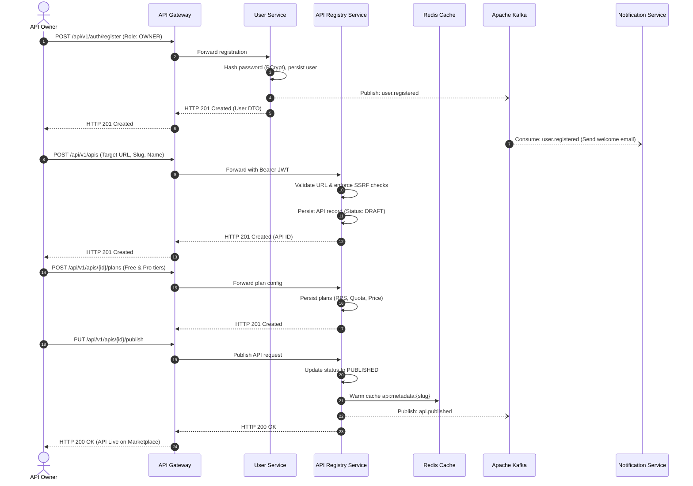
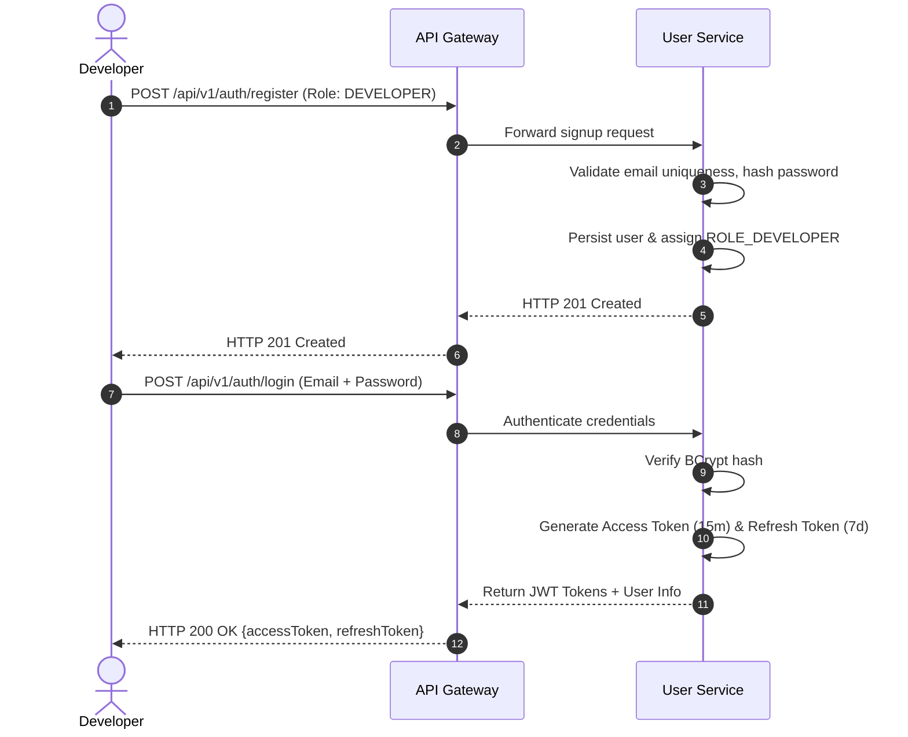
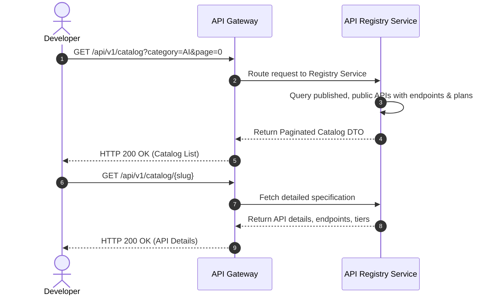
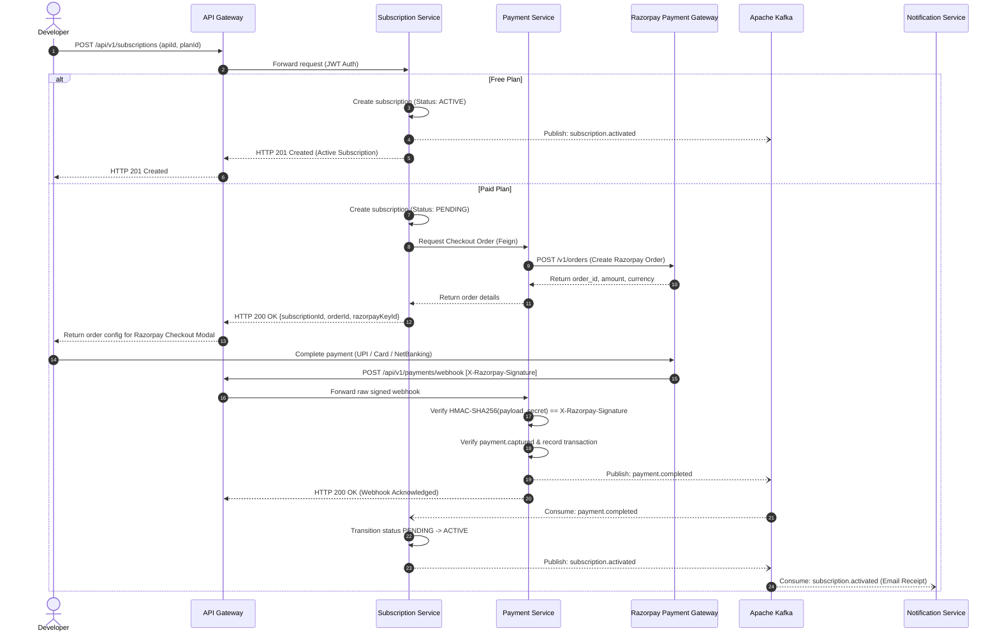
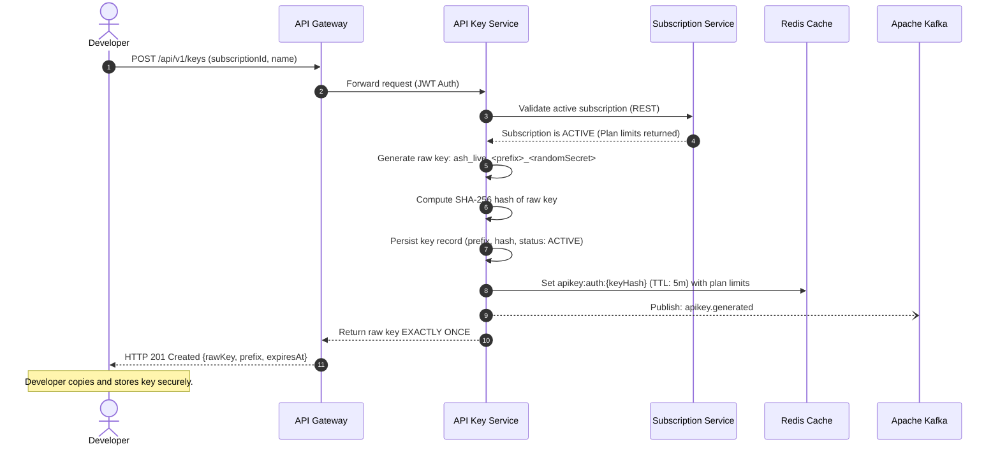
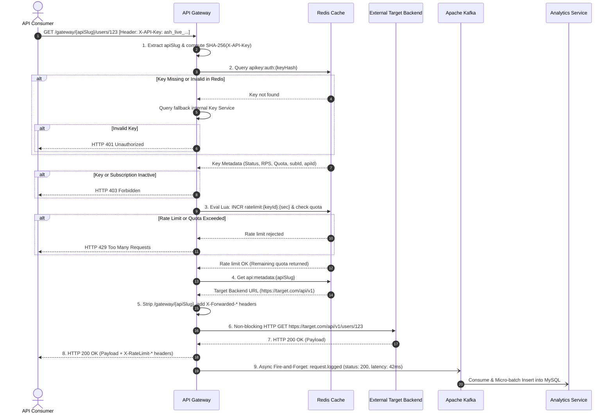

# APIShield — Complete System Flows & Gateway Lifecycle

## 1. Complete System Workflows

This document outlines the end-to-end interactions across APIShield components, detailing each major operational flow with accompanying Mermaid sequence diagrams.

---

### Flow A: Owner Registration and API Publishing

An API Owner creates an account, logs in, registers their backend API, defines path endpoints, and configures monetization/usage plans.



---

### Flow B: Developer Registration and Authentication

A client developer signs up, authenticates, and obtains a JSON Web Token (JWT) containing their identity and assigned roles.



---

### Flow C: API Marketplace and Discovery

Developers browse public, published APIs and inspect their documentation, available endpoints, and pricing plans.



---

### Flow D & K: API Subscription and Payment Activation

Handling both Free tier direct activation and Paid tier checkout via **Razorpay** (Orders API, Checkout Modal, and HMAC-SHA256 signature verification).



---

### Flow E: API Key Generation

Developers generate a cryptographically secure API key for an active subscription.



---

### Flow F, G, H, I, J: Complete Gateway Request Execution Lifecycle

The runtime execution flow when an external client invokes an API via the Gateway:



---

## 2. API Gateway Complete Request Lifecycle (Phase-by-Phase)

The Gateway request filter pipeline executes across nine distinct phases:

```
[ Phase 1: Receive ] ──> [ Phase 2: Identify Route ] ──> [ Phase 3: Validate API Key ]
                                                                   │
                                                                   ▼
[ Phase 6: Resolve Backend ] <── [ Phase 5: Rate Limit & Quota ] <── [ Phase 4: Validate Sub ]
        │
        ▼
[ Phase 7: Forward Request ] ──> [ Phase 8: Return Response ] ──> [ Phase 9: Async Telemetry ]
```

### Phase 1: Receive Developer Request
- Inspects incoming HTTP connection, establishes read timeout handler.
- Generates a globally unique `X-Correlation-ID` (UUID) if not already provided.
- Extracts `X-API-Key` header from request. If absent, halts pipeline and triggers 401 error flow.

### Phase 2: Identify API Route
- Parses URI path: `/gateway/{apiSlug}/**`.
- Extracts `{apiSlug}` to identify the target API.
- Re-writes path to strip the gateway prefix (e.g. `/gateway/weather-api/v1/current` becomes `/v1/current`).

### Phase 3: Validate API Key
- Hashes the extracted raw API key with SHA-256.
- Executes an $O(1)$ in-memory lookup in Redis: `apikey:auth:{keyHash}`.
- If cache-miss, performs a resilient fallback query (indexed with logarithmic complexity $O(\log N)$ against the database) to API Key Service and caches the result for 300 seconds.
- Confirms key `status == 'ACTIVE'`.

### Phase 4: Validate Subscription
- Checks subscription status embedded in key cache: `subscriptionStatus == 'ACTIVE'`.
- Verifies current timestamp falls within `[current_period_start, current_period_end]`.

### Phase 5: Check Rate Limits and Quotas
- Executes atomic Redis Lua script enforcing sliding-window requests per second (RPS).
- Checks monthly usage counter `quota:{subscriptionId}:{YYYY_MM}` against plan quota limit.
- If either check fails, halts pipeline immediately and returns HTTP 429 with `Retry-After` header.

### Phase 6: Retrieve Backend Routing Configuration
- Retrieves cached routing definition `api:metadata:{apiSlug}` from Redis.
- Resolves base target backend URL (e.g., `https://api.externalbackend.com`).
- Performs SSRF protection validation to ensure backend IP does not resolve to private/loopback address space.

### Phase 7: Forward Request to External Backend
- Dispatches non-blocking HTTP request via Project Reactor Netty `HttpClient`.
- Injects standard tracing and proxy headers:
  - `X-Correlation-ID`: Trace ID.
  - `X-Forwarded-For`: Original client IP.
  - `X-Forwarded-Host`: Original hostname.
- Connect timeout: 2,000 ms. Read timeout: 5,000 ms (or custom per-API timeout).
- Protected by Resilience4j Circuit Breaker.

### Phase 8: Return Response to Client
- Receives response stream from external backend.
- Attaches rate limit telemetry headers (`X-RateLimit-Limit`, `X-RateLimit-Remaining`, `X-RateLimit-Reset`, `X-Correlation-ID`).
- Flushes response body and HTTP status code directly to client.

### Phase 9: Publish Analytics Event Asynchronously
- Captures total roundtrip latency, HTTP status code, request size, response size, and timestamp.
- Emits an asynchronous, non-blocking telemetry event to Kafka topic `apishield.gateway.analytics`.
- Zero impact on client response latency.

---

## 3. Comprehensive Error Handling & RFC 7807 Format

All error responses generated by the API Gateway adhere to the **RFC 7807 Problem Details for HTTP APIs** specification:

```json
{
  "type": "https://apishield.io/errors/RATE_LIMIT_EXCEEDED",
  "title": "Too Many Requests",
  "status": 429,
  "detail": "You have exceeded your plan's burst rate limit of 20 requests per second.",
  "instance": "/gateway/weather-api/v1/forecast",
  "timestamp": "2026-11-18T10:15:30Z",
  "correlationId": "8f3b610c-33b6-4b98-bc1c-59be610731f2"
}
```

### Error Scenarios & Gateway Action Matrix

| Failure Condition | HTTP Status | RFC 7807 Type Code | Gateway Action & Client Guidance |
| :--- | :--- | :--- | :--- |
| **Missing API Key Header** | `401 Unauthorized` | `MISSING_API_KEY` | Request missing `X-API-Key` header. Direct client to pass valid key. |
| **Invalid / Unrecognized Key** | `401 Unauthorized` | `INVALID_API_KEY` | Key hash not found in Redis or database. Client must check key accuracy. |
| **Revoked API Key** | `403 Forbidden` | `REVOKED_API_KEY` | Key exists but status is `REVOKED`. Client must generate a new key. |
| **Inactive Subscription** | `403 Forbidden` | `SUBSCRIPTION_INACTIVE` | Subscription is `PENDING`, `SUSPENDED`, or `CANCELLED`. Direct client to developer portal. |
| **Expired Subscription** | `403 Forbidden` | `SUBSCRIPTION_EXPIRED` | Billing period lapsed. Client must renew or update payment method. |
| **Burst Rate Limit Exceeded** | `429 Too Many Requests`| `RATE_LIMIT_EXCEEDED` | Exceeded plan's RPS threshold. Gateway returns `Retry-After: 1` header. |
| **Monthly Quota Exhausted** | `429 Too Many Requests`| `QUOTA_EXHAUSTED` | Monthly request limit consumed. Direct client to upgrade plan tier. |
| **Unavailable Target Backend** | `502 Bad Gateway` | `BACKEND_UNAVAILABLE` | External backend connection refused, DNS lookup failed, or SSL handshake error. |
| **Target Backend Timeout** | `504 Gateway Timeout`| `BACKEND_TIMEOUT` | External backend failed to respond within configured read timeout (e.g. 5s). |
| **Circuit Breaker Open** | `503 Service Unavailable`| `CIRCUIT_BREAKER_OPEN`| Downstream target backend has sustained high failure rate; requests short-circuited. |
| **SSRF Policy Violation** | `400 Bad Request` | `INVALID_BACKEND_URL` | Target backend resolved to a forbidden private IP address range. |
