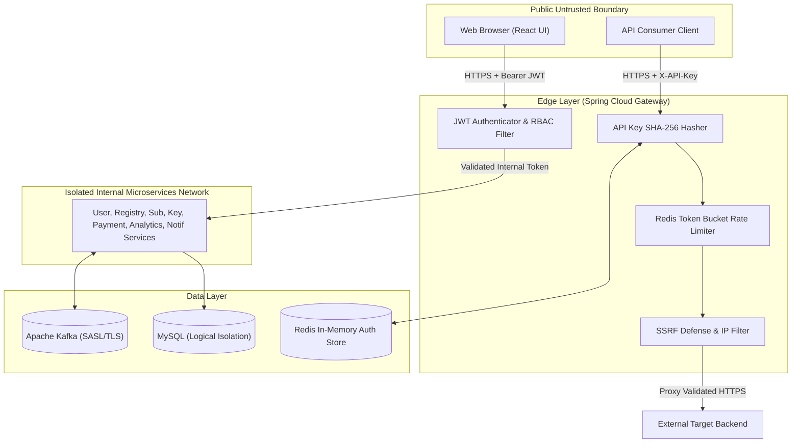
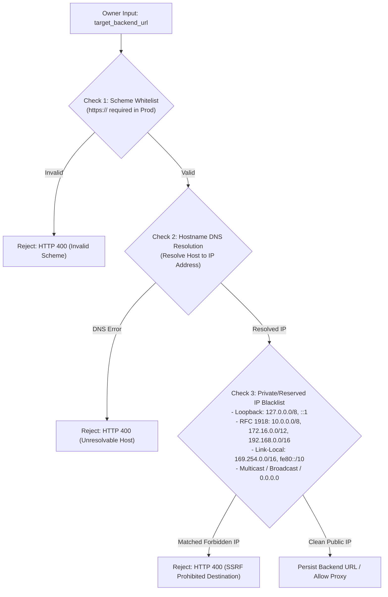
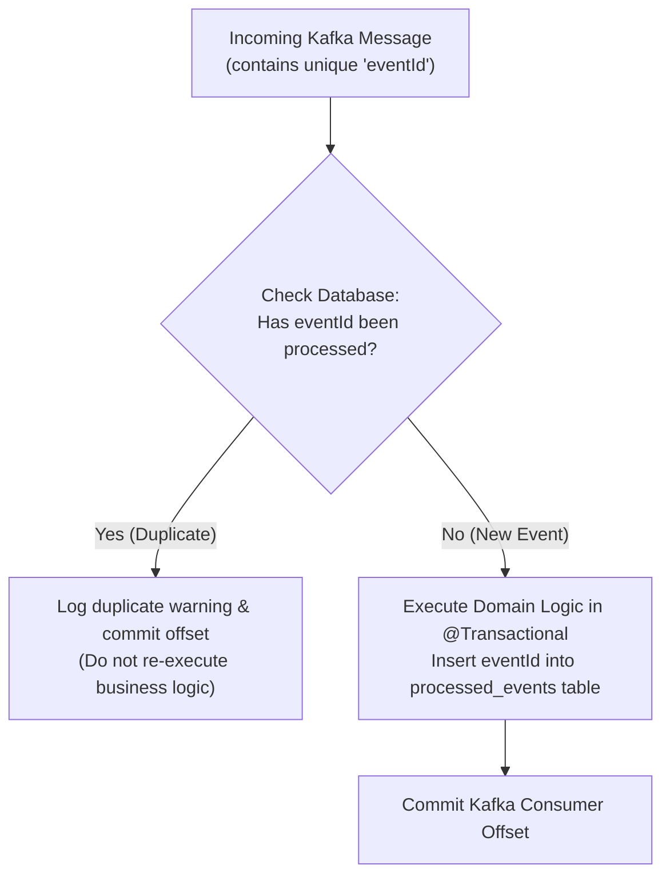

# APIShield — Security Architecture & Threat Mitigation

## 1. Security Overview

APIShield operates as both a public edge gateway and a multi-tenant API management platform. Securing the platform requires a defense-in-depth model that addresses both Control Plane interactions (user management, administrative operations) and Data Plane interactions (high-speed API proxying, external backend protection, SSRF prevention).



---

## 2. Authentication & Authorization (Control Plane)

### 2.1 JWT (JSON Web Token) Architecture
All administrative and management operations (`/api/v1/**`) require authentication via standard OAuth2 / JWT bearer tokens.

- **Token Pair Strategy:**
  - **Access Token:** Short-lived (15 minutes). Contains cryptographic claims for identity and roles. Signed using HMAC-SHA512 (or RSA-256 with asymmetric key pairs).
  - **Refresh Token:** Long-lived (7 days). Stored securely (e.g. `HttpOnly`, `SameSite=Strict` cookie or secure storage) and used strictly to rotate access tokens.
- **Token Claims Payload:**
  ```json
  {
    "sub": "9b1deb4d-3b7d-4bad-9bdd-2b0d7b3dcb6d",
    "email": "developer@company.com",
    "roles": ["ROLE_DEVELOPER"],
    "userId": "usr_7721",
    "iss": "apishield-auth-server",
    "iat": 1774000000,
    "exp": 1774000900
  }
  ```

### 2.2 Role-Based Access Control (RBAC)
APIShield defines three discrete operational roles:

| Role | Target Persona | Permissions & Scope |
| :--- | :--- | :--- |
| `ROLE_OWNER` | API Providers | Register new APIs, modify endpoints, create pricing plans, view analytics for owned APIs, withdraw revenues. |
| `ROLE_DEVELOPER` | API Consumers | Browse public catalog, subscribe to APIs, generate/revoke API keys, inspect personal usage and billing history. |
| `ROLE_ADMIN` | Platform Operators | Full administrative oversight: suspend accounts, freeze malicious APIs, inspect platform-wide Prometheus metrics. |

All internal REST endpoints enforce strict method security via Spring Security annotations (e.g. `@PreAuthorize("hasRole('OWNER')")`).

---

## 3. API Key Architecture (Data Plane)

### 3.1 Key Format & Generation
API Keys are designed to combine human-readable identification with cryptographic entropy:

```
Format: ash_live_{prefix}_{secret}
Example: ash_live_a1b2c3d4_8f7e6d5c4b3a2019e8d7c6b5a43210fe
```
- `ash_live_`: Constant platform prefix (enabling automated secret scanning by tools like GitHub Secret Scanning).
- `{prefix}`: 8-character random alphanumeric string. Stored in plaintext and displayed in dashboards to allow developers to identify individual keys without revealing the secret.
- `{secret}`: 32-character cryptographically secure random token generated using `java.security.SecureRandom`.

### 3.2 One-Way Cryptographic Hashing
- Under no circumstances is a raw API key ever written to persistent disk storage or application logs.
- During generation:
  1. The raw key is assembled: `rawKey = "ash_live_" + prefix + "_" + secret`.
  2. The SHA-256 cryptographic digest is computed: `keyHash = Hex(SHA-256(rawKey))`.
  3. The `keyHash` and `prefix` are persisted to `apishield_apikey.api_keys`.
  4. The complete `rawKey` is returned in the API response **exactly once**. The developer is prompted to store it securely.

### 3.3 Verification at Edge Gateway
1. When an incoming request arrives with `X-API-Key: ash_live_...`, the Gateway computes `SHA-256(X-API-Key)`.
2. The Gateway checks Redis key: `apikey:auth:{keyHash}` in constant $O(1)$ time.
3. If found, the request proceeds immediately with zero database lookups.
4. If missing (cache miss), a fallback query checks the API Key Service database using the `idx_api_keys_key_hash` index. Because the database uses a B-tree index, this query operates with logarithmic complexity ($O(\log N)$), rather than constant time. The retrieved key metadata is then cached in Redis for 300 seconds to ensure subsequent requests remain $O(1)$. If no key matches, the request is rejected with HTTP 401.

### 3.4 Key Revocation & Instant Cache Eviction
When a key is compromised or revoked by a developer:
1. API Key Service updates key status to `REVOKED` in MySQL.
2. Synchronously deletes Redis key `apikey:auth:{keyHash}`.
3. Publishes `apikey.revoked` event to Kafka topic `apishield.apikey.events` to guarantee immediate eviction across all distributed Gateway nodes.

---

## 4. Backend URL Validation & SSRF Prevention

### 4.1 Threat Model: Server-Side Request Forgery (SSRF)
When an API Owner registers an API, they provide a `target_backend_url`. A malicious owner could exploit the Gateway's proxy capability to mount attacks against:
- Internal microservices within the Docker network (`http://user-service:8081`).
- Cloud provider instance metadata endpoints (`http://169.254.169.254/latest/meta-data/`).
- Localhost or loopback interfaces on the host machine (`http://127.0.0.1:3306`, `http://localhost:8080`).

### 4.2 Multi-Layered SSRF Defense Implementation



#### Layer 1: Protocol Whitelisting
Only `https://` is permitted in production environments. Unencrypted `http://` is strictly prohibited unless an explicit development flag (`apishield.security.allow-insecure-http=true`) is activated in local docker environments.

#### Layer 2: IP Range Blacklisting
The hostname is resolved via DNS prior to registration and verified against a comprehensive subnet blacklist:
- `127.0.0.0/8` (IPv4 Loopback)
- `::1/128` (IPv6 Loopback)
- `10.0.0.0/8` (Private Class A)
- `172.16.0.0/12` (Private Class B)
- `192.168.0.0/16` (Private Class C)
- `169.254.0.0/16` (IPv4 Link-Local / AWS/GCP Metadata)
- `fe80::/10` (IPv6 Link-Local)
- `0.0.0.0/8`, `240.0.0.0/4`, `255.255.255.255/32` (Reserved/Broadcast)

#### Layer 3: DNS Rebinding Defense
To prevent DNS rebinding attacks (where a domain resolves to a public IP during registration but shifts to `127.0.0.1` at runtime):
- The API Gateway executes DNS resolution and IP blacklisting checks directly before opening downstream proxy sockets via a custom Netty `AddressResolverGroup`.

---

## 5. Request Timeouts & Circuit Breaking

To protect the Gateway from connection starvation when external target backends experience degradation:
- **Connection Timeout:** 2,000 milliseconds.
- **Read Timeout:** 5,000 milliseconds (configurable per API up to a maximum platform cap of 30,000 ms).
- **Circuit Breakers (Resilience4j):**
  - If 50% of requests to a specific backend fail over a sliding window of 20 requests, the circuit transitions to `OPEN`.
  - While `OPEN`, subsequent requests are immediately rejected with HTTP 503 (`CIRCUIT_BREAKER_OPEN`), protecting platform resources.

---

## 6. Network Security & Inter-Service Trust

- **Network Isolation:** All backend microservices, MySQL databases, Redis, and Kafka brokers reside in an internal Docker bridge network (`apishield-internal-network`). None of these services expose ports to the public host in production.
- **Single Public Ingress:** The API Gateway is the only service that binds to public ports (8080/443).
- **Internal Request Verification:** Requests routed from the Gateway to internal microservices carry an internal cryptographic signature header (`X-Internal-Token`) generated using a shared HMAC secret. Internal services reject any requests lacking a valid internal signature.

---

## 7. Sensitive Environment Variables & Secrets Management

APIShield adheres to the **Twelve-Factor App** configuration principles:
- No passwords, encryption keys, or API tokens are hardcoded in source code or Git repositories.
- Configuration placeholders are used in `application.yml` and injected via Docker Compose `.env` files or container orchestration secrets:

| Variable Name | Purpose | Example / Format |
| :--- | :--- | :--- |
| `APISHIELD_JWT_SECRET` | Signing key for JWT Access/Refresh tokens | 512-bit Base64-encoded string |
| `APISHIELD_INTERNAL_SECRET`| Shared HMAC secret for internal service calls | 256-bit Base64-encoded string |
| `SPRING_DATASOURCE_PASSWORD`| Database user password per microservice | High-entropy random string |
| `RAZORPAY_KEY_ID` | Public Key ID for client Razorpay Checkout Modal | `rzp_live_...` |
| `RAZORPAY_KEY_SECRET` | Private Key Secret for Razorpay Orders API | High-entropy random secret |
| `RAZORPAY_WEBHOOK_SECRET` | HMAC-SHA256 signature verification secret for webhooks | High-entropy random secret |
| `KAFKA_SASL_PASSWORD` | Kafka broker authentication credential | High-entropy string |

---

## 8. Kafka Event Security & Idempotency

### 8.1 Event Transport Security
- Kafka brokers operate with **SASL/SCRAM-SHA-512** authentication.
- All inter-broker and client-to-broker traffic is encrypted using TLS (in production).

### 8.2 Duplicate Event Handling & Consumer Idempotency
Because Kafka guarantees *at-least-once* message delivery, network retries can result in duplicate event consumption. To prevent duplicate charges, double subscription activations, or duplicated notifications, all event consumers implement the **Idempotent Consumer Pattern**:



1. Every published event includes a unique UUID (`eventId`).
2. Consumers record processed `eventId` entries in a dedicated `processed_events` table within their logical schema inside the same `@Transactional` boundary as the business logic.
3. If an event arrives with an `eventId` already present in `processed_events`, the consumer skips execution and commits the Kafka offset immediately.

---

## 9. Security & Reliability Architecture for Core Decisions

### 9.1 Maven Multi-Module Centralized Governance
In distributed microservices, version skew across shared dependencies represents a critical security risk (e.g. differing, unpatched versions of Spring Security, Nimbus JOSE JWT, Netty, or Jackson across services). 
- **Centralized Bill of Materials (`backend/pom.xml`):** The parent POM coordinates `<dependencyManagement>` for all 9 microservices and the `backend/common` module.
- **Single-Point CVE Remediation:** Upgrading a vulnerable library version in `backend/pom.xml` instantly updates all services upon recompile, guaranteeing uniform security baselines across the platform.
- **Elimination of Transitive Conflicts:** Prevents silent runtime ClassNotFoundException or NoSuchMethodError bugs that compromise service reliability.

### 9.2 Strict Boundary Isolation for `backend/common`
A shared module in a microservices ecosystem risks becoming an anti-pattern ("distributed monolith") if domain logic or data models leak into it.
- **Contract-Only Scope:** `backend/common` is restricted strictly to immutable protocol contracts (Kafka `EventEnvelope<T>`, event payload DTOs, RFC 7807 problem details models, common headers).
- **Prohibition of Persistence Entities:** JPA `@Entity` classes and repository interfaces are prohibited from `backend/common`. This guarantees that internal schema changes in one service cannot break or force recompilation of unrelated services.
- **Zero Business Logic & Minimal Dependencies:** Restricting `backend/common` to standard Java/Spring essentials avoids transitive dependency bloat and prevents security vulnerabilities in one domain from propagating across the boundary to other services.

### 9.3 Razorpay Payment Security, Webhook Verification & Idempotency
Because payment processing directly controls subscription activation and resource provisioning:
- **HMAC-SHA256 Webhook Verification:** All incoming Razorpay webhook payloads received at `POST /api/v1/payments/webhook` are verified using cryptographic HMAC-SHA256 signatures:
  $$\text{computedSignature} = \text{Hex}(\text{HMAC-SHA256}(\text{rawPayload}, \text{RAZORPAY\_WEBHOOK\_SECRET}))$$
  Requests where `computedSignature != X-Razorpay-Signature` are rejected with HTTP 400 Bad Request and logged as security alerts.
- **Checkout Signature Validation:** Client-side payment completion is verified server-side using the tri-part hash:
  $$\text{expectedSignature} = \text{Hex}(\text{HMAC-SHA256}(\text{razorpay\_order\_id} + "|" + \text{razorpay\_payment\_id}, \text{RAZORPAY\_KEY\_SECRET}))$$
- **Replay Protection & Idempotent Processing:** Webhooks and verification calls check `payment_transactions` for existing `gateway_tx_id` / `gateway_payment_id`. If a payment has already been verified and processed, the duplicate event is acknowledged safely without triggering secondary `payment.completed` events or duplicate subscription activations.
