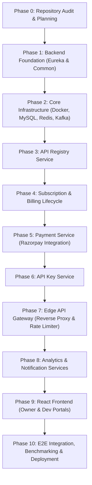

# APIShield — Comprehensive Implementation Roadmap

## 1. Executive Summary & Purpose

This document provides the complete, authoritative, and sequentially ordered technical roadmap for implementing the entire **APIShield API Management and Security Platform**. 

APIShield enables API Owners to publish, monetize, and govern backend APIs, while enabling client Developers to discover APIs via an interactive catalog, subscribe to plans, acquire cryptographically secure API keys, and consume APIs through a low-latency, resilient API Gateway.

The system is engineered as a **Java 21 LTS / Spring Boot 3.3+ microservices architecture** with a **React 18+ Single Page Application**, backed by **MySQL 8.0+ (Logical Database-per-Service)**, **Redis 7.x**, **Apache Kafka 3.x**, and **Spring Cloud Netflix Eureka**.

---

## 2. Global Architectural Rules & Standards

Throughout all implementation phases, the following architectural principles must be strictly enforced:

1. **Separation of Control Plane and Data Plane:**
   - **Control Plane:** (`user-service`, `api-registry-service`, `subscription-service`, `api-key-service`, `payment-service`, `analytics-service`, `notification-service`) handles management workflows, state machines, billing, and dashboards.
   - **Data Plane:** (`api-gateway` + `Redis`) executes sub-millisecond reverse proxying, API key SHA-256 validation, token bucket rate limiting, monthly quota checks, SSRF filtering, and asynchronous telemetry publishing. No synchronous SQL lookups on the data plane proxy critical path.
2. **Database-per-Service (Logical Isolation):**
   - Each service strictly manages its own dedicated logical database schema.
   - Zero cross-service SQL joins, zero cross-schema foreign keys.
   - Inter-service entity relationships are modeled strictly using immutable UUID strings (`userId`, `apiId`, `subscriptionId`, `apiKeyId`).
3. **Maven Multi-Module Architecture & Minimal Common Module:**
   - Root project managed by `backend/pom.xml` with `<dependencyManagement>`.
   - `backend/common` module is strictly minimal: it contains only event envelopes, shared domain event payload DTOs, RFC 7807 error models, shared header constants, and lightweight crypto utilities.
   - **Strictly forbidden in `common`:** JPA `@Entity` classes, Spring Data repositories, business logic, or third-party provider SDKs.
4. **Asynchronous Event-Driven Decoupling (Kafka):**
   - Cross-boundary side effects (e.g. payment completion -> subscription activation -> API key provisioning; proxy request -> analytics ingestion) are communicated via durable Kafka topics with standardized `EventEnvelope<T>`.
5. **Defense-in-Depth Edge Security:**
   - Spring Cloud Gateway acts as edge ingress.
   - API keys follow the high-entropy prefix format `ash_live_{prefix}_{secret}`, validated in Redis via SHA-256 cryptographic digests in $O(1)$ time.
   - Strict SSRF defense with private IP blacklists before proxying to registered target backend URLs.
6. **Code Quality & Testing Discipline:**
   - Clean Architecture, constructor injection, DTO isolation, Jakarta Bean Validation.
   - Flyway database migrations for 100% of schema definitions.
   - Unit tests, MockMvc/WebTestClient integration tests, and Postman collections for every service.
   - Keep all existing tests passing at every step.

---

## 3. Microservice Network Map & Port Allocations

| Component | Port | Description | Database Schema / Store |
| :--- | :--- | :--- | :--- |
| **API Gateway** | `8080` | Public edge ingress, reverse proxy, rate limiter & SSRF guard | Redis (`db:0`), Kafka |
| **User Service** | `8081` | Authentication, RBAC, JWT issuance, profile & admin operations | `apishield_user` (MySQL) |
| **API Registry Service**| `8082` | API catalog, target URLs, endpoints, monetization plans | `apishield_registry` (MySQL) |
| **Subscription Service**| `8083` | Developer subscription lifecycle, state transitions | `apishield_subscription` (MySQL) |
| **API Key Service** | `8084` | Secure API key generation, SHA-256 hashing, revocation | `apishield_apikey` (MySQL) |
| **Payment Service** | `8085` | Razorpay checkout orders, HMAC webhook verification, billing | `apishield_payment` (MySQL) |
| **Notification Service**| `8086` | Event-driven email dispatch, transactional alerts | `apishield_notification` (MySQL) |
| **Analytics Service** | `8087` | High-throughput Kafka log ingestion, rollup aggregation | `apishield_analytics` (MySQL) |
| **Eureka Server** | `8761` | Service discovery registry & client-side load balancing | Ephemeral In-Memory |
| **MySQL Database** | `3306` | Multi-tenant persistent relational database | 7 Logical Schemas |
| **Redis Cache** | `6379` | Key auth, token bucket counters, monthly quotas | In-Memory / AOF |
| **Apache Kafka** | `9092` | Event bus & telemetry stream (`apishield.*`) | Commit Log |
| **Prometheus** | `9090` | Timeseries metric scraping | Ephemeral / Disk |
| **Grafana** | `3000` | Platform telemetry dashboards | SQLite / Dashboards |
| **React Frontend** | `5173` | Developer marketplace, API Owner console, Admin dashboard | Node 20 / Vite |

---

## 4. Phased Implementation Breakdown

---

### Phase 0: Repository Audit, Architectural Alignment & Implementation Planning
- **Status:** COMPLETED
- **Objective:** Perform a rigorous audit of the repository, document verified vs missing features, and produce the complete multi-phase implementation roadmap and progress tracker.
- **Affected Components:** `docs/implementation/implementation-roadmap.md`, `docs/implementation/implementation-status.md`.
- **Verification Criteria:** Audit published, status tracker initialized, Phase 1 approval requested from user.

---

### Phase 1: Backend Foundation (Eureka Discovery Server & Common Library)
- **Status:** PENDING APPROVAL
- **Objective:** Establish the Maven multi-module aggregator, build the minimal shared `backend/common` module, configure the Spring Cloud Netflix Eureka Discovery Server, and link `user-service` to Eureka.
- **Prerequisites:** Phase 0 complete.
- **Steps:**
  1. **Root Maven Aggregator (`backend/pom.xml`):**
     - Create root parent POM with `<dependencyManagement>` unifying Spring Boot 3.3+, Spring Cloud 2023.0+, Lombok, Jackson, and test libraries.
     - Configure child modules: `common`, `discovery-server`, `user-service`.
  2. **Minimal Common Module (`backend/common`):**
     - Implement standard event envelope: `EventEnvelope<T>` and `EventMetadata`.
     - Implement shared domain event payload DTOs: `UserRegisteredEvent`, `SubscriptionActivatedEvent`, `PaymentCompletedEvent`, `ApiKeyRevokedEvent`, `ApiPublishedEvent`.
     - Implement standard RFC 7807 problem details response: `ProblemDetailResponse`.
     - Implement shared constants: `X-Correlation-ID`, `X-Internal-Token`, `X-API-Key`.
     - Implement SHA-256 hashing utility (`CryptoUtils`).
     - Write unit tests for `common` components.
  3. **Eureka Discovery Server (`backend/discovery-server`):**
     - Create Spring Boot 3.3+ application on port `8761`.
     - Add `@EnableEurekaServer`.
     - Configure `application.yml` with self-preservation, standalone mode (`register-with-eureka: false`, `fetch-registry: false`).
     - Add health actuator and test suite verifying server startup and registry endpoints.
  4. **Connect User Service to Eureka:**
     - Add `spring-cloud-starter-netflix-eureka-client` to `backend/user-service/pom.xml`.
     - Enable Eureka client in `application.yml` with configurable Eureka URL.
     - Verify all 101 existing User Service tests still pass without regressions.
- **Affected Services:** `backend/pom.xml`, `backend/common`, `backend/discovery-server`, `backend/user-service`.
- **Automated Tests:** Common serialization/deserialization tests, Eureka server context and dashboard tests, User Service regression tests.
- **Git Commit:** `feat(foundation): initialize maven multi-module, common library, and eureka discovery server`

---

### Phase 2: Core Infrastructure & Local Orchestration
- **Status:** PLANNED
- **Objective:** Provide a turnkey Docker Compose environment provisioning multi-tenant MySQL schemas, Redis with rate-limiting support, Apache Kafka broker with pre-initialized topics, and monitoring stubs.
- **Prerequisites:** Phase 1 complete.
- **Steps:**
  1. **MySQL Multi-Schema Init (`infrastructure/mysql/init-databases.sql`):**
     - Script to create 7 isolated databases: `apishield_user`, `apishield_registry`, `apishield_subscription`, `apishield_apikey`, `apishield_payment`, `apishield_notification`, `apishield_analytics`.
     - Create dedicated service database users and grant minimal least-privilege permissions.
  2. **Redis In-Memory Tier (`infrastructure/redis/redis.conf`):**
     - Configure maxmemory, LRU eviction policy (`volatile-lru`), and persistence (`appendonly yes`).
  3. **Kafka Broker & Topic Provisioning (`infrastructure/kafka/`):**
     - Dockerized Apache Kafka in KRaft mode (or Kafka + Zookeeper).
     - Automated shell script to create partitions and replication factors for topics:
       - `apishield.user.events` (3 partitions)
       - `apishield.registry.events` (3 partitions)
       - `apishield.subscription.events` (3 partitions)
       - `apishield.payment.events` (3 partitions)
       - `apishield.apikey.events` (3 partitions)
       - `apishield.gateway.analytics` (6 partitions)
       - `apishield.notification.events` (3 partitions)
  4. **Master Docker Compose (`infrastructure/docker/docker-compose.yml`):**
     - Services: `mysql`, `redis`, `kafka`, `eureka-server`, with dependencies, health checks, and persistent named volumes.
     - `.env.example` at root detailing all infrastructure environment variables.
  5. **Verification Script:**
     - Powershell/Bash healthcheck script validating connectivity across MySQL, Redis, and Kafka.
- **Git Commit:** `feat(infra): provision multi-schema mysql, redis, kafka topics, and docker compose orchestration`

---

### Phase 3: API Registry Service
- **Status:** PLANNED
- **Objective:** Build `backend/api-registry-service` (Port 8082) enabling API Owners to register backend APIs, define endpoint path patterns, configure monetization/quota plans, enforce SSRF defense, and expose a public marketplace catalog.
- **Prerequisites:** Phase 1 & 2 complete.
- **Steps:**
  1. **Project Scaffolding & Eureka Client:**
     - Initialize `backend/api-registry-service` (Spring Boot 3.3+, Java 21, JPA, MySQL, Flyway, Eureka client, Kafka producer, Redis).
  2. **Database Migration (`V1__create_registry_tables.sql`):**
     - Tables: `apis`, `api_endpoints`, `api_plans`.
     - Indexes on `slug` (UNIQUE), `owner_id`, `category`, `status`.
  3. **Domain Models & Repositories:**
     - Entities: `Api`, `ApiEndpoint`, `ApiPlan` with optimistic locking and audit fields.
  4. **SSRF Defense Engine (`SsrfProtectionValidator`):**
     - Strict URL parsing, schema validation (`http`, `https` only).
     - DNS resolution check blocking loopbacks (`127.0.0.1`, `::1`), private ranges (RFC 1918 `10.0.0.0/8`, `172.16.0.0/12`, `192.168.0.0/16`), link-local (`169.254.0.0/16`), and internal Docker container names.
  5. **API Management Operations (`ApiController`):**
     - `POST /api/v1/apis`: Create API in `DRAFT` status (Owner only).
     - `GET /api/v1/apis`: List APIs owned by current user.
     - `GET /api/v1/apis/{id}`: Detailed API view.
     - `PUT /api/v1/apis/{id}`: Update API metadata / backend URL.
     - `POST /api/v1/apis/{id}/endpoints`: Add path pattern (`/current`, `/forecast/**`, HTTP methods).
     - `POST /api/v1/apis/{id}/plans`: Configure plan (Free/Paid, RPS, monthly quota, price in cents).
     - `PUT /api/v1/apis/{id}/publish`: Transition status `DRAFT` -> `PUBLISHED`, warm Redis `api:metadata:{slug}`, publish Kafka `api.published`.
     - `PUT /api/v1/apis/{id}/deprecate`: Mark `DEPRECATED`, evict Redis cache.
  6. **Public Marketplace Catalog (`CatalogController`):**
     - `GET /api/v1/catalog`: Public paginated search by keyword/category.
     - `GET /api/v1/catalog/{slug}`: Public detailed specification with plans & endpoints.
  7. **Internal Gateway Resolution Endpoint:**
     - `GET /api/v1/internal/apis/resolve/{slug}`: Fast JSON lookup for Gateway cache-miss resolution.
  8. **Testing & Postman:**
     - Unit tests for SSRF validator, integration tests for API lifecycle, Postman collection for Registry Service.
- **Git Commit:** `feat(registry): implement api registry service with ssrf protection, monetization plans, and marketplace catalog`

---

### Phase 4: Subscription & Billing Lifecycle
- **Status:** PLANNED
- **Objective:** Build `backend/subscription-service` (Port 8083) to manage developer subscriptions, implement state machine transitions (`PENDING`, `ACTIVE`, `CANCELLED`, `EXPIRED`, `SUSPENDED`), auto-activate Free plans, and emit subscription events.
- **Prerequisites:** Phase 3 complete.
- **Steps:**
  1. **Project Scaffolding & Database Migration:**
     - Initialize `backend/subscription-service` with MySQL `apishield_subscription` and Eureka client.
     - Flyway `V1__create_subscriptions_table.sql` with unique index `(developer_id, api_id, status)`.
  2. **Inter-Service Communication (OpenFeign):**
     - Feign client querying `api-registry-service` for plan validation (`GET /api/v1/internal/plans/{planId}`).
  3. **Subscription Lifecycle Service:**
     - `POST /api/v1/subscriptions`: Subscribe to plan.
       - If `plan.priceCents == 0`: Instant activation (`status = ACTIVE`), publish `subscription.activated`.
       - If `plan.priceCents > 0`: Create subscription in `PENDING` status, initiate payment flow.
     - `GET /api/v1/subscriptions/my`: List subscriptions for authenticated developer.
     - `GET /api/v1/subscriptions/{id}`: Subscription details and current period.
     - `POST /api/v1/subscriptions/{id}/cancel`: Cancel subscription (`status = CANCELLED`), publish `subscription.cancelled`.
  4. **Kafka Event Consumer & State Transitions:**
     - Consume `apishield.payment.events`: on `payment.completed`, transition `PENDING` -> `ACTIVE` and publish `subscription.activated`.
     - Consume `apishield.payment.events`: on `payment.failed`, transition `PENDING` -> `SUSPENDED`.
  5. **Internal Validation Endpoint:**
     - `GET /api/v1/internal/subscriptions/validate?developerId={id}&apiId={id}`: Returns active status and plan rate limits for API Key Service.
  6. **Testing & Postman:**
     - Unit tests, MockMvc integration tests with embedded Kafka, Postman collection.
- **Git Commit:** `feat(subscription): implement subscription service with lifecycle state machine and event-driven activation`

---

### Phase 5: Payment Service (Razorpay Integration)
- **Status:** PLANNED
- **Objective:** Build `backend/payment-service` (Port 8085) to handle monetization, create Razorpay checkout orders, securely verify webhook signatures using HMAC-SHA256, track payment transactions, and emit billing events.
- **Prerequisites:** Phase 4 complete.
- **Steps:**
  1. **Project Scaffolding & Database Migration:**
     - Initialize `backend/payment-service` with MySQL `apishield_payment` and Eureka client.
     - Flyway `V1__create_payment_tables.sql`: `payments`, `invoices`, `webhook_logs`.
  2. **Razorpay Client Integration:**
     - Wrapper service for Razorpay Orders API (`POST /v1/orders`).
     - Configurable keys (`razorpay.key-id`, `razorpay.key-secret`).
     - Mock client mode for test environments.
  3. **Payment Operations (`PaymentController`):**
     - `POST /api/v1/payments/create-order`: Generates Razorpay Order ID for pending subscription.
     - `POST /api/v1/payments/verify`: Verifies client checkout signature (`razorpay_order_id`, `razorpay_payment_id`, `razorpay_signature`).
     - `POST /api/v1/payments/webhook`: Webhook endpoint with HMAC-SHA256 verification of `X-Razorpay-Signature`.
     - Idempotent transaction processing (prevents double activation on webhook replays).
     - On successful payment: Persist record, publish `payment.completed` to `apishield.payment.events`.
  4. **Invoicing & Billing History:**
     - `GET /api/v1/payments/history`: List developer invoices and transactions.
  5. **Testing & Postman:**
     - Webhook signature verification tests, Mock Razorpay server integration tests, Postman collection.
- **Git Commit:** `feat(payment): implement payment service with razorpay checkout, hmac webhook verification, and event dispatch`

---

### Phase 6: API Key Service
- **Status:** PLANNED
- **Objective:** Build `backend/api-key-service` (Port 8084) to generate high-entropy API keys (`ash_live_{prefix}_{secret}`), store only SHA-256 digests, manage key revocation, synchronize Redis cache, and auto-revoke on subscription termination.
- **Prerequisites:** Phase 4 & 5 complete.
- **Steps:**
  1. **Project Scaffolding & Database Migration:**
     - Initialize `backend/api-key-service` with MySQL `apishield_apikey` and Eureka client.
     - Flyway `V1__create_api_keys_table.sql`: `api_keys` (`id`, `developer_id`, `api_id`, `subscription_id`, `prefix`, `key_hash`, `status`, `expires_at`).
  2. **Cryptographic Key Generation (`SecureRandom`):**
     - Generate raw key: `ash_live_` + 8-char random prefix + `_` + 32-char hex secret (128 bits entropy).
     - Compute SHA-256 hash. Store `prefix` and `key_hash`. Never store raw secret.
     - Raw key returned in response strictly once.
  3. **Key Management Operations (`ApiKeyController`):**
     - `POST /api/v1/keys`: Generate API key. Validates active subscription with Subscription Service. Warmed to Redis `apikey:auth:{keyHash}`.
     - `GET /api/v1/keys`: List keys for developer (masks secret, displays prefix only).
     - `DELETE /api/v1/keys/{id}`: Revoke key. Evicts Redis cache, publishes `apikey.revoked`.
     - `POST /api/v1/keys/{id}/rotate`: Atomically generate new key and revoke old key.
  4. **Redis Cache Synchronization & Kafka Listeners:**
     - Sync active keys to Redis hash: `{"apiKeyId", "developerId", "apiId", "subscriptionId", "status", "rateLimitRps", "monthlyQuota"}`.
     - Consume `apishield.subscription.events`: On `subscription.cancelled` or `expired`, revoke all associated API keys and evict Redis.
  5. **Internal Gateway Fallback Endpoint:**
     - `GET /api/v1/internal/keys/lookup/{keyHash}`: B-Tree index lookup for Gateway cache misses.
  6. **Testing & Postman:**
     - Entropy and hashing verification tests, rotation tests, Redis sync tests, Postman collection.
- **Git Commit:** `feat(apikey): implement api key service with sha256 hashing, redis sync, and subscription binding`

---

### Phase 7: Edge API Gateway (Reverse Proxy & Rate Limiter)
- **Status:** PLANNED
- **Objective:** Build `backend/api-gateway` (Port 8080) using Spring Cloud Gateway (Project Reactor / Netty), routing Control Plane management traffic and executing the high-performance 9-phase Data Plane proxy lifecycle.
- **Prerequisites:** Phases 1–6 complete.
- **Steps:**
  1. **Project Scaffolding & Eureka Load Balancing:**
     - Initialize reactive Spring Cloud Gateway with Redis Reactive client and Kafka producer.
     - Configure Control Plane routes to Eureka services (`/api/v1/auth/**` -> `user-service`, `/api/v1/apis/**` -> `api-registry-service`, etc.).
  2. **Data Plane 9-Phase Proxy Filter (`DataPlaneProxyFilter`):**
     - **Phase 1: Correlation ID Injection:** Generate `X-Correlation-ID` UUID header if absent.
     - **Phase 2: Route Resolution:** Extract `/gateway/{apiSlug}/**`. Fetch target URL from Redis `api:metadata:{slug}` (or fallback to Registry Service).
     - **Phase 3: API Key Extraction & Hashing:** Extract `X-API-Key` (reject if missing with 401). Compute `SHA-256(X-API-Key)`.
     - **Phase 4: Key Authentication:** Query Redis `apikey:auth:{keyHash}`. Verify status is `ACTIVE` and `apiId` matches resolved route.
     - **Phase 5: Burst Rate Limiting (Token Bucket):** Execute atomic Redis Lua script checking sliding second window against `rateLimitRps`. Return 429 Too Many Requests if exceeded.
     - **Phase 6: Monthly Quota Enforcement:** Atomic `INCR` on `quota:{subscriptionId}:{YYYY_MM}`. Return 429 Quota Exceeded if over plan limit.
     - **Phase 7: Target Backend Safety & SSRF Validation:** Re-validate target backend IP safety before connection.
     - **Phase 8: Upstream Proxying:** Non-blocking forwarding via Netty HttpClient with strip-prefix, configurable timeouts, and Resilience4j circuit breaker.
     - **Phase 9: Asynchronous Telemetry Emission:** Emit request metrics (status, duration, bytes, timestamp) to Kafka `apishield.gateway.analytics`.
  3. **Gateway Error Handling:**
     - Reactive RFC 7807 problem details error responses.
  4. **Testing & Postman:**
     - MockWebServer proxy tests, rate limiter tests, quota boundary tests, Postman collection.
- **Git Commit:** `feat(gateway): implement reactive api gateway with 9-phase proxy lifecycle, redis rate limiting, and kafka telemetry`

---

### Phase 8: Analytics Service & Notification Service
- **Status:** PLANNED
- **Objective:** Build `backend/analytics-service` (Port 8087) for telemetry log ingestion and rollup reporting, and `backend/notification-service` (Port 8086) for event-driven alerts.
- **Prerequisites:** Phase 7 complete.
- **Steps:**
  1. **Analytics Service (`backend/analytics-service`):**
     - Scaffolding, Eureka client, MySQL `apishield_analytics`.
     - Flyway `V1__create_analytics_tables.sql`: `request_logs`, `hourly_rollups`, `daily_rollups`.
     - High-throughput Kafka consumer for `apishield.gateway.analytics` using batching.
     - Scheduled rollup aggregation engine (computes p50, p95, p99 latency, success/error rates).
     - Owner endpoints: `/api/v1/analytics/owner/{apiId}/traffic`, `/api/v1/analytics/owner/{apiId}/latency`, `/api/v1/analytics/owner/revenue`.
     - Developer endpoint: `/api/v1/analytics/dev/{subscriptionId}/usage`.
     - Admin platform overview: `/api/v1/analytics/admin/platform-overview`.
  2. **Notification Service (`backend/notification-service`):**
     - Scaffolding, Eureka client, MySQL `apishield_notification`.
     - Flyway `V1__create_notification_tables.sql`: `notifications`, `email_outbox`.
     - Kafka consumers for user registration, subscription activation, payment confirmation, and key revocation.
     - In-app notification endpoints (`GET /api/v1/notifications`).
  3. **Testing & Postman:**
     - Analytics aggregation tests, Kafka consumer tests, Postman collections.
- **Git Commit:** `feat(analytics-notification): implement analytics rollup engine and event-driven notification service`

---

### Phase 9: React Frontend (Developer Marketplace, Owner Console & Admin Dashboard)
- **Status:** PLANNED
- **Objective:** Build a responsive, high-performance React 18+ Single Page Application with Tailwind CSS providing intuitive interfaces for API Owners, Developers, and Administrators.
- **Prerequisites:** Phases 1–8 complete.
- **Steps:**
  1. **Vite + React Scaffolding (`frontend/`):**
     - Initialize Vite, React 18+, React Router 6, Tailwind CSS, Axios, Lucide React, Recharts.
     - Configure Axios interceptors for JWT Bearer attachment, 401 automatic refresh token rotation, and `X-Correlation-ID`.
  2. **Auth & Session Management:**
     - Login, Register (Developer / Owner selection), Forgot Password, Email Verification views.
     - Global AuthContext preserving user profile and role state.
  3. **Public Marketplace & Discovery:**
     - Searchable, categorized catalog grid.
     - API detail page with endpoint documentation, sample code snippets (cURL, Python, JS), and plan comparison matrix.
  4. **Developer Portal:**
     - My Subscriptions view with status badges and expiry dates.
     - Plan checkout modal with Razorpay payment button integration.
     - API Key Management: Generate key modal (single-view raw key display with copy-to-clipboard), key listing (masked secrets), revoke button.
     - Interactive API Testing Playground.
     - Usage analytics charts (requests over time, remaining quota progress bar).
  5. **API Owner Console:**
     - Dashboard with owned API metrics (total requests, revenue, active subscribers).
     - API Registration Wizard: Target backend URL, slug, description, category.
     - Endpoint Builder: Path pattern, HTTP method rules.
     - Plan Creator: Free / Paid tier pricing, burst RPS, monthly quota.
     - Publish / Unpublish toggles.
     - Revenue and traffic breakdown charts.
  6. **Admin Dashboard:**
     - System overview, user management, API moderation, health telemetry.
  7. **Build & Test:**
     - Production build verification (`npm run build`).
- **Git Commit:** `feat(frontend): implement react spa with developer marketplace, owner console, and admin dashboard`

---

### Phase 10: End-to-End System Integration, Benchmarking & Deployment Verification
- **Status:** PLANNED
- **Objective:** Execute full system integration verification, automated end-to-end regression tests across all 9 microservices and frontend, stress test the API Gateway proxy path, and deliver comprehensive deployment runbooks.
- **Prerequisites:** Phases 1–9 complete.
- **Steps:**
  1. **Full-Stack Docker Compose Orchestration:**
     - Unified Docker Compose launching all 9 microservices, MySQL, Redis, Kafka, Eureka, React frontend, Prometheus, and Grafana.
  2. **Automated E2E Test Suite (`tests/e2e/`):**
     - Scripted flow executing complete business journey:
       1. Owner registers & publishes API (`weather-mock`).
       2. Developer registers & browses catalog.
       3. Developer subscribes to Pro plan (Razorpay checkout mock).
       4. Developer generates API key `ash_live_...`.
       5. Developer invokes `/gateway/weather-mock/current` with `X-API-Key`.
       6. Gateway validates key in Redis, proxies to mock backend, returns HTTP 200.
       7. Burst rate limit test: 50 concurrent requests trigger HTTP 429.
       8. Gateway publishes telemetry to Kafka.
       9. Analytics Service aggregates log into hourly rollup.
       10. Developer views usage dashboard reflecting exact request count.
  3. **Master Postman Collection:**
     - Consolidated Postman collection covering all services with automated pre-request scripts and test assertions.
  4. **Monitoring & Observability:**
     - Prometheus scrape configs for all Spring Boot Actuator endpoints.
     - Pre-configured Grafana dashboard visualizing Gateway RPS, latency percentiles (p95/p99), and error rates.
  5. **Documentation & Release Sign-off:**
     - Updated root `README.md` with complete architecture diagram, setup commands, and API documentation.
- **Git Commit:** `feat(e2e): complete end-to-end integration test suite, docker orchestration, and observability dashboards`

---

## 5. Verification & Acceptance Criteria

Every phase will be marked complete only when:
1. All unit and integration tests compile and pass.
2. No existing functionality is regressed or removed.
3. Flyway migrations execute cleanly without manual intervention.
4. Postman collection files are generated and updated.
5. Code adheres to clean architecture, DTO isolation, and constructor injection.
6. Progress is tracked and committed to Git with clear semantic messages.
